# 黑暗之池（Pools of Darkness）繁體中文化與 HD

以 [dosgolem](https://github.com/wicanr2/dosgolem) 執行 SSI DOS 版《Pools of Darkness》，
在執行期攔截原版輸出，呈現繁體中文與 HD 重繪圖。原版遊戲、規則與存檔保持原樣，需自備原版。

本專案另修正軟體世界珍藏版說明書的錯譯，並把修正後的手札放進遊戲，劇情引用時直接開啟。

在其他機器重建請讀[SETUP.md](SETUP.md)。必要HD成品、開源字型來源與重建清單已存於本儲存庫；原版遊戲資料需自備。

正式版為`v.1.0.0-20261102`，包含五語、B版海報、F1無敵、片頭與片尾HD，並支援持續滑鼠移動、左右鍵及查驗題自動填答。玩家按Enter確認，F9可關閉輔助。三平台各有基本／HD patch及本機完整版，共十二包；另有同版號63秒1080p推廣影片。操作與交付位置見[SETUP](SETUP.md#目前交付)，驗收範圍見[正式版交付](docs/re/039-v1-release.md)。Linux實際封包與Windows Wine已抽驗，原生Windows及macOS真機未驗。舊36包與影片保持；新編配樂試聽仍未完成。

## 重返菲蘭城

十年來，你們走遍王國，挫敗邪惡勢力的陰謀。如今船隻駛入月之海的港灣，昔日滿目瘡痍的菲蘭城已重建高塔與街市。
擊敗泰蘭特拉克斯的英雄回到成名之地，迎接你們的似乎是一段難得的太平日子。

但班恩並未放棄。籠罩月之海的黑暗即將把隊伍帶離熟悉的街道，穿過次元傳送池，迎向龍族、黑暗精靈與異界的敵人。
這場旅程從重返家園開始，最後要面對的，是威脅整個王國的力量。

本作是 SSI 於 1991 年推出的 AD&D《被遺忘的國度》角色扮演遊戲，也是這套四部曲的第四作。
玩家組成冒險隊伍，探索城鎮與地下城、閱讀手札線索，並在回合制戰鬥中安排移動、武器與法術。
故事背景整理自 [SSI《冒險者手冊》導言](https://www.mocagh.org/ssi/pod-journal.pdf)與本作開場文字；
原文來源與版本見[參考文件紀錄](docs/re/002-reference-sources.md)。

## 本專案做了什麼

遊戲仍由 dosgolem 執行原版 DOS 程式。繁體中文與 HD 透過呈現層覆繪，原版規則、資料判定、亂數與存檔保持原樣。
手札採用經英文原文校正的珍157 譯文，事件引用時直接顯示；另有遊戲內攻略與地圖疊層，減少來回翻閱紙本的需要。

文字依畫面倍率使用原生字模：2 倍為 16×16，3 倍為 24×24。已辨識的 8×8 英數字也直接在高解析畫布重畫，
保留數值、配色與字格位置；F12 可切回原版畫面。以下是同一次正常讀檔畫面的原始像素裁切，
驗收範圍見[字模接管與高解析呈現](docs/spec/025-direct-render-commands.md#resident-glyph-ready)。

| 原版 8×8 字模放大至 3 倍 | 原生 24×24 字模 |
|---|---|
|  |  |

繁中已驗證冷啟動、建角、存讀檔、查驗題與部分探索路徑。人物 HD 主題的 81 個狀態已完成，去重後 78 項，
已接入並做正常 DEMO 抽樣。七張 BIGPIC 已接入，其中第 244 張通過正常 DEMO 抽樣，其他六張依完整來源條件辨識；其他圖族的素材與接入範圍見[目前狀態](CONTEXT.md)。
戰鬥怪物的 244 個 CPIC 來源狀態已完成重畫，去重後 238 張；地下城 DUNGCOM 六組共150張非純色圖樣已接入，六個純色背景格保留原色。
野外WILDCOM三組119個非純色來源已完成，去重後116張HD，一格純色維持原版；包含樹叢、水岸、岩石、垂直輪廓與環形池。
正常冷啟動、倍率與原版切換抽樣通過；尚未遇到的怪物與地形仍依完整原版來源條件辨識。
戰鬥特效的 44 個來源已有素材對應，共 36 張成品。六類來源與正常 DEMO 抽驗通過；未遇事件依完整來源條件辨識，有位置歧義時保留原版。
素材覆蓋與實機驗證範圍見[研究017](docs/re/017-vga-battle-hd.md#b39-effects)。
另有九張天空與地下城背景成品，依完整來源與使用色盤條件選用；正常出現位置與遮擋尚未驗證。
遭遇圖29組共87張距離素材已齊全，依完整來源與使用色盤條件選用。正常流程中的041近景與遠景抽驗通過，透明區保留原版場景；其他正常事件仍待驗證。
開場封面、世界標誌、製作名單與兩側海報文字已接入，F8依繁中、英文、日文、韓文、簡中循環。
五種語系均提供99則手札、78段攻略、已知地圖名稱與攻略點。日韓介面、劇情、物品與姓名音譯已接入，使用原生16／24字模及工具列12／22字模。日韓為機器翻譯，經語境校讀，未經母語者審校。範圍見[多語系規格](docs/spec/015-multilingual.md#日文與韓文收尾)。

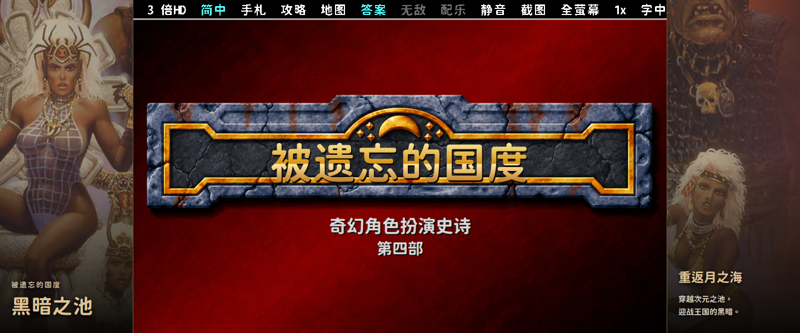

| 英文攻略正常讀檔截圖 | 英文手札分頁排版樣本 |
|---|---|
| 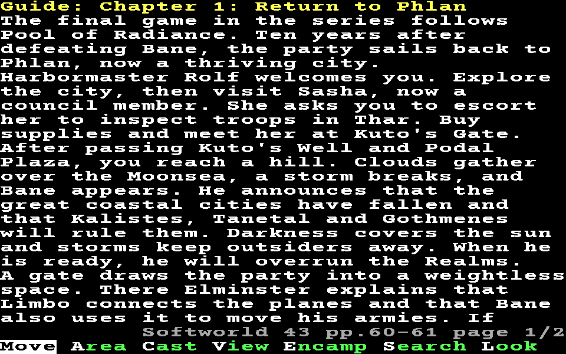 | 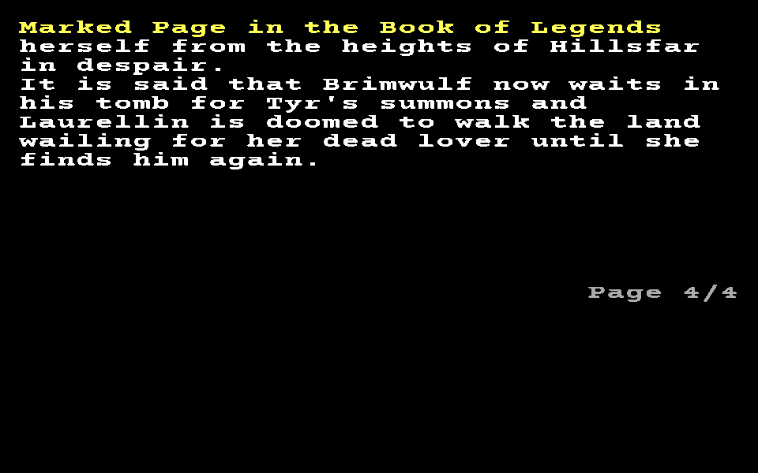 |

左圖由正常玩家路線擷取。右圖是手札元件的排版樣本，展示長文完整分頁；不代表本輪重播了該手札的劇情觸發。

| 日文攻略：正常讀檔路線 | 韓文攻略：正常讀檔路線 |
|---|---|
| 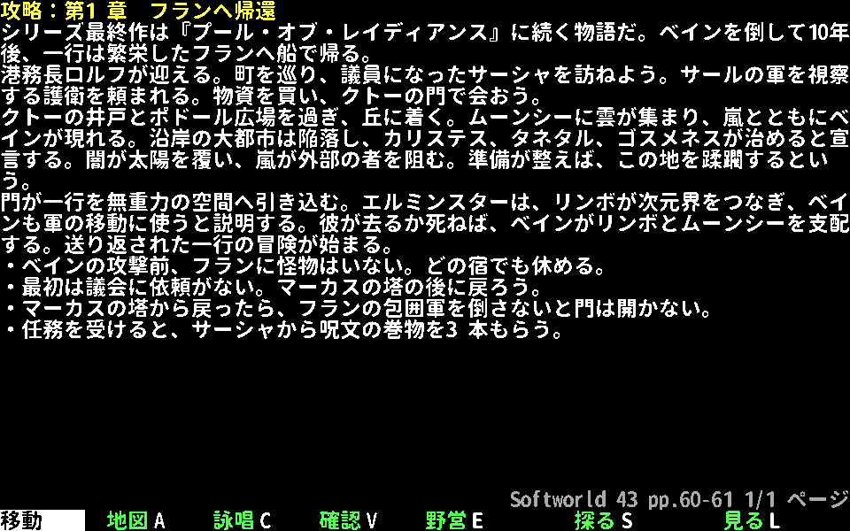 | 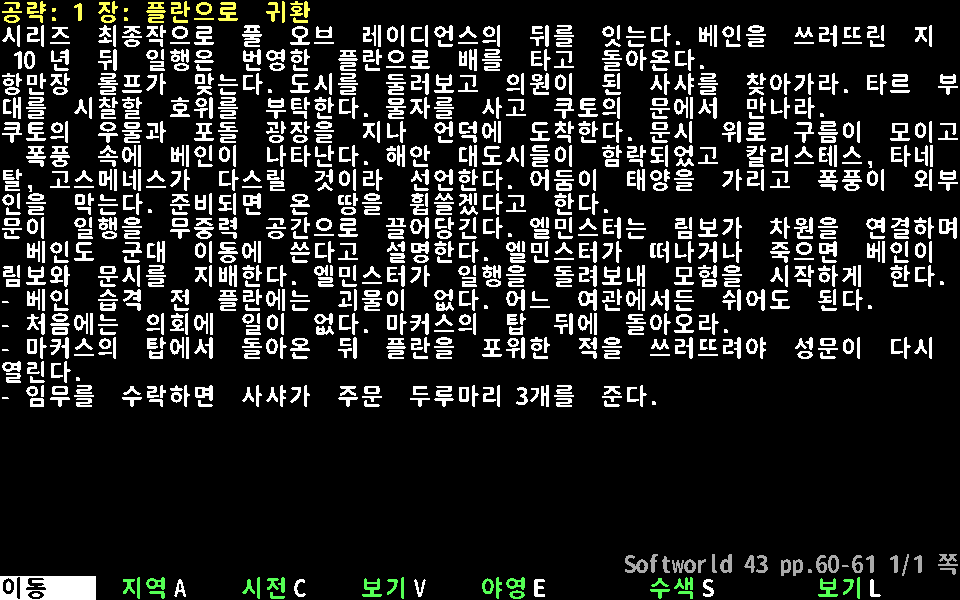 |

兩圖取自正常冷啟動、讀取槽A後的遊戲內攻略。繁中、日文與韓文各完成4,800格抽樣，原版終點與132個客體檔案一致；手札與攻略另通過全表分頁檢查。[日韓驗收範圍](docs/re/034-jako-runtime.json)保留正常路線與局部手札排版的區別。

片頭八組台詞提供這五種語系、2／3 倍與 F12 原版；繁中與英文正常播放的[字幕驗收](docs/re/018-movie-subtitles.md#正式呈現層與正常視窗驗收)通過，簡中另以既有正常來源抽驗。日韓範圍以[開場與讀檔抽樣](docs/re/034-jako-runtime.json)為準。
片頭97種敘事HD相位已由原版BMA呼叫驅動，保留淡出、變形與布幕。SSI標誌維持原版，片尾另計。
菲蘭起點的天空、地面與牆面也已接入，完整讀檔抽樣通過。
完整現況與驗證範圍見 [CONTEXT.md](CONTEXT.md)。

已驗路徑改用直接繪圖命令。最終畫面先選 HD 與文字，只有未覆蓋的像素才填入原版顏色，
避免先鋪滿原版底圖再覆畫 HD。畫布與子表面初始化、字模、共享搬移／填色與清零、RLE 封包、單點、限定矩形與逐列續行、水平及垂直線、斜線與相交裁切、表面矩形搬移、整數縮放與原地翻轉、表面像素轉場、正半徑橢圓外框與填滿橢圓、八平面與直接色號圖像列、部分 VGA 圖像處理、色盤資料流程與回掃等待已由 Go 演算法接手；像素路徑支援事件邊界與短預算續做，初始化整段預算不足時保留原版。
圖像 header、RGB 與填色幾何也支援最低一步的 Go 資料續行，保留原版寫入順序與虛擬時點。
連通填色的左右像素搜尋與讀點短續行也由 Go 處理。固定相容區塊不得讀寫可見畫布。
BIOS 查詢、原版內容選擇、文字組句及呼叫編排保持原流程；未支援條件保留安全回退。
圖片來源、列控制、RLE、矩形、使用色號、色盤陣列準備、淡出及完整 RGB 輸出有正常路線驗收；圖片裁切與翻轉另有受控原圖驗證。
已支援的 VGA 繪圖核心已完成收尾。標題、完整片頭、讀檔介面、戰鬥 DEMO 及正常存讀檔六條路線，
共 15,073,225 個畫面位元組全由 Go 演算法計畫寫入，固定效果與原 x86 像素寫入皆為 0，狀態、畫面與存檔維持一致。
[驗收範圍與相容邊界](docs/spec/025-direct-render-commands.md#draw-closure-conformed)另列，未走場景不外推。

## 畫面介紹

### 遊戲封面：原版與 HD

| 原版封面 | 繁中 HD 實際畫面 |
|---|---|
| 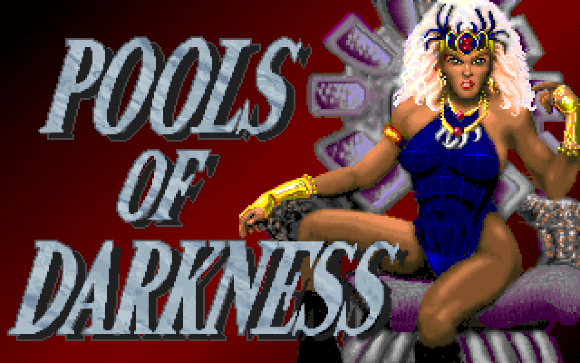 |  |

左圖由 `TITLE.DAX` 第 2 塊解碼，與正常冷啟動原版畫面逐像素一致；右圖是實際遊戲截圖。
HD 採完整藍紫色禮服，保留女王、王冠與寶座構圖。標題文字與美術分離，F8 可切為英文。

| 英文 HD 封面 | 含兩側海報的完整封面視窗 |
|---|---|
| 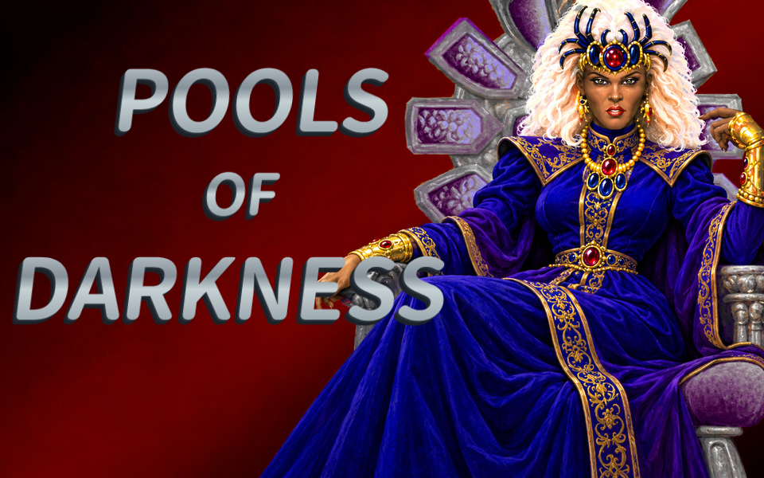 | 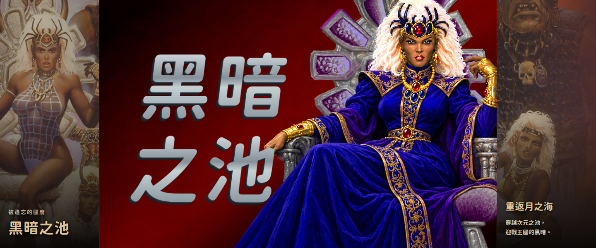 |

| 繁中封面重繪素材 | 英文封面重繪素材 |
|---|---|
|  |  |

這兩張是重繪素材預覽；上方封面與海報視窗是實際遊戲截圖。封面視窗保留早期A版海報，現行B版見下方片頭實際視窗。

三張開場圖與語系切換的原版狀態比較、零閃現範圍見[開場驗收](docs/re/014-vga-hd.md#開場與英文正常路徑驗收)。

### 片頭 HD

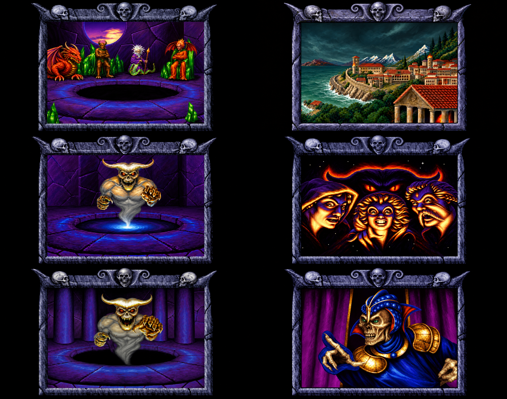

六張960×504成品按原尺寸拼列，保留原配色、構圖、石框與黑邊，排除下方字幕。
上圖是六張主畫面預覽。執行時另有97種敘事相位，依原版輸出選圖；材質變形與HD明暗屬美術近似。
原版並列與內建生圖提示詞見[片頭審閱頁](review/hd/b44-intro/README.md)，[預覽來源](docs/screenshots/intro-keyframes-hd-preview.json)及[素材驗收](docs/re/018-b44-materials.json)另列。
片頭動畫的[來源與接入](docs/re/031-intro-bma.md)及[97種相位審閱](review/hd/b46-intro/README.md)已保存。正常5100回合與F2／F8／F12抽樣通過，原版狀態及127個DOS檔案相同；原量尺保留全黑轉場與明示切換記錄，未發現非預期可見閃現。

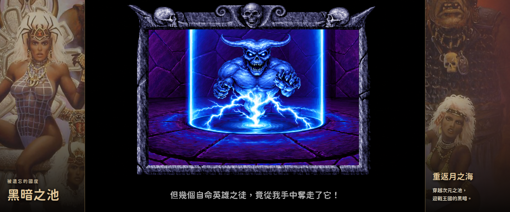

這是採B版海報的正常開場實際視窗，逐像素同核准原型；來源與驗收見[執行期收據](docs/re/033-hd-patch-runtime.json)。

### 片尾 HD

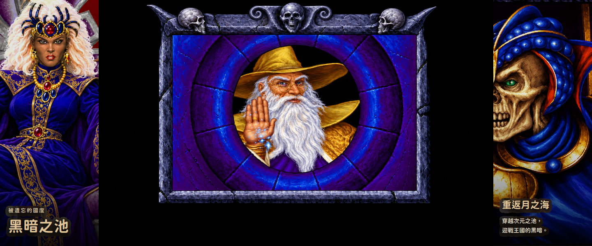

片尾六區塊58圖由43種HD相位涵蓋，包含巨龍、菲蘭城復原、法師揮手及關門。上圖取自Linux容器中的原版VACE片尾播放器直接入口，使用3倍HD與繁中海報；沒有重播完整通關。原版圖格順序與狀態保持，F2／F8／F12抽驗通過。
[原版並列與生成紀錄](review/hd/b48-final/README.md)、[截圖來源](docs/screenshots/final-hd-runtime.json)及[驗收範圍](docs/re/035-final-hd.md)另列。

### 原版 BIGPIC 與 HD 重畫

| 原版 BIGPIC | HD 重繪預覽 |
|---|---|
| 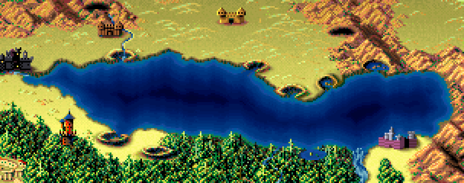 | 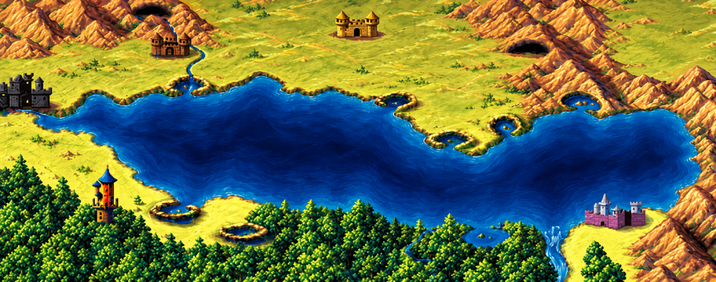 |
| 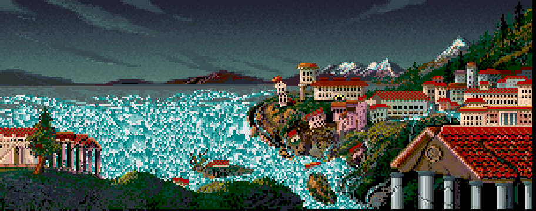 | 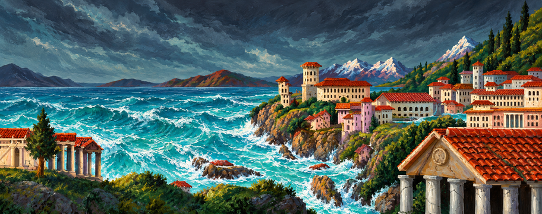 |
|  |  |

左側從本作 `BIGPIC1.DAX` 區塊 240、243、246 解碼，以 3 倍最近鄰顯示；右側是依原圖手繪風格重畫的 912×360 素材。
這一批畫風已確認，上表為素材預覽。
來源與 SHA-256 見[展示圖清單](docs/screenshots/manifest.json)，完整並列與提示詞見 [HD 審閱頁](review/hd/README.md)。
HD 製作與接入進度由 [#10](https://github.com/wicanr2/pools-of-darkness-cht/issues/10) 追蹤。

### BIGPIC 實際遊戲對照

| 原版美術，3 倍顯示 | HD 實際畫面，3 倍顯示 |
|---|---|
| 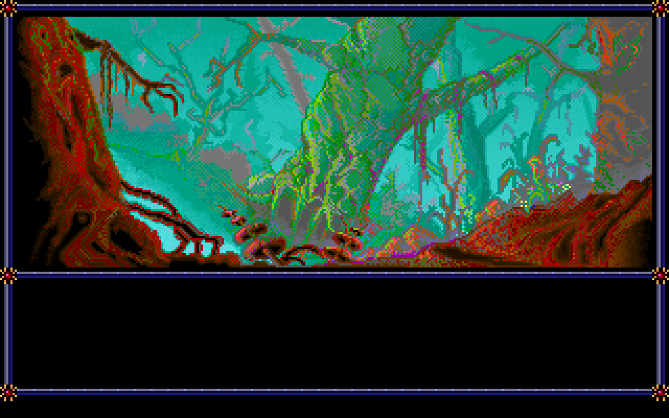 | 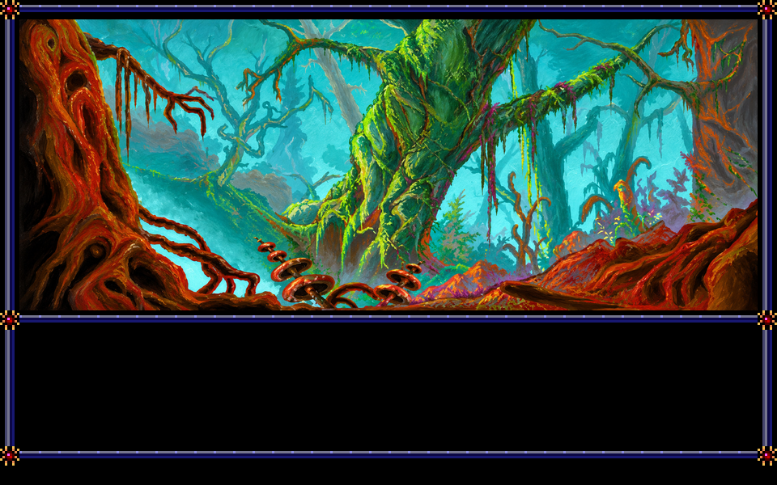 |

兩張取自相同冷啟動 DEMO 的第 3650 格，顯示 `BIGPIC1.DAX` 第 244 張；HD 差異只在原版 304×120 圖框內。
這組是實際遊戲截圖；上方的地圖、港灣與魔法戰鬥則是素材預覽。來源與驗證範圍見[研究014](docs/re/014-vga-hd.md#bigpic正常來源補證)。

### 繁中與 HD 實際畫面

| 原版 DOS 畫面 | 繁中與 HD，3 倍顯示 |
|---|---|
| 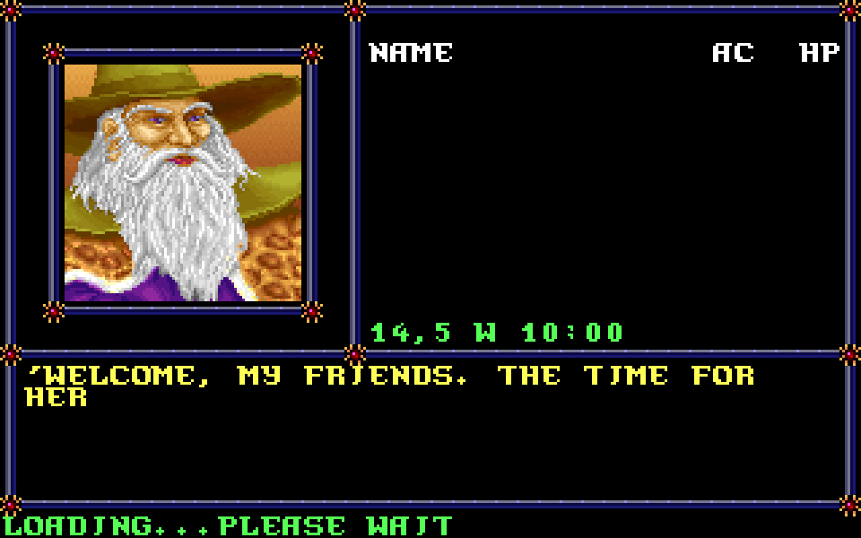 |  |
| 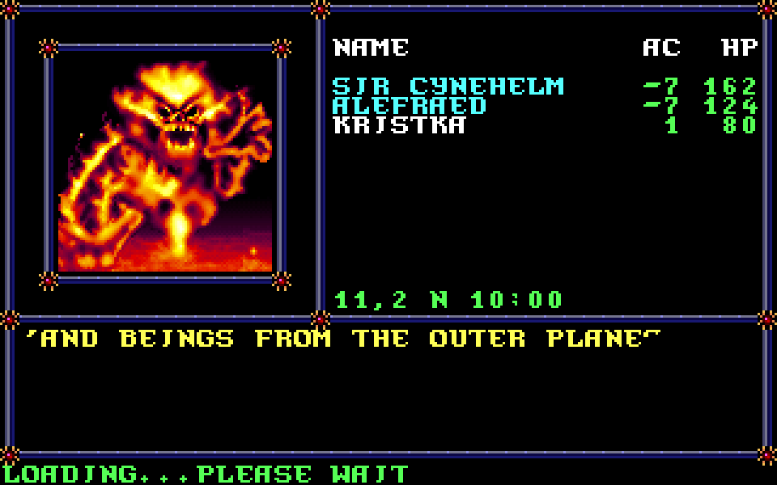 | 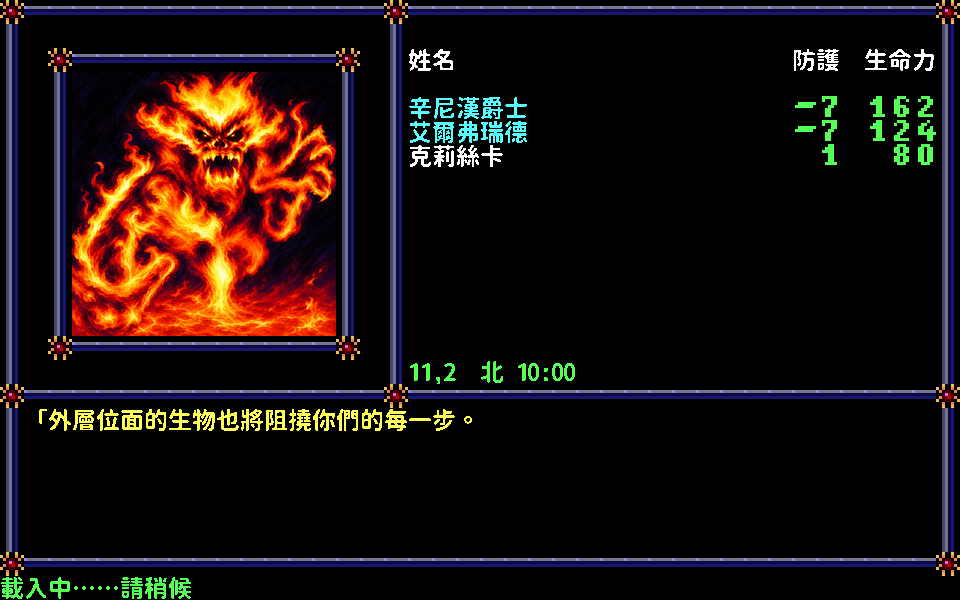 |

以上是 dosgolem 執行 DEMO 的 960×600 畫面。右側繁中與 HD 另以正常冷啟動核對，像素完全一致。
兩張小圖已接入；同狀態比較確認 HD 差異只落在原版圖框，原版記憶體、暫存器、色號與存檔一致。
目前展示範圍為開場 DEMO，冷啟動到戰鬥的抽樣路線閃現為 0；其餘圖族仍在製作與驗證。

| 原版戰鬥 | 繁中與首批戰鬥 HD |
|---|---|
| 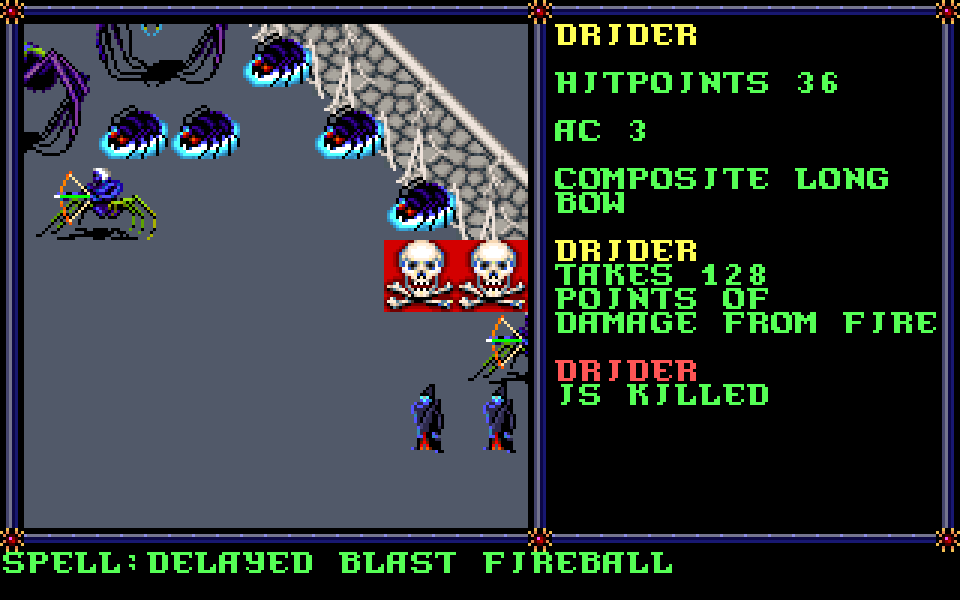 |  |

本批包含半蜘蛛精靈、吸血鬼法師、電蜘蛛及兩張石牆。完整冷啟動 7,400 格的閃現為 0，
HD、無 HD、F12 原版及 2 倍四路的 CPU、記憶體、色號、色盤與 127 個 DOS 檔案一致。
完整戰鬥視窗如下，兩側保留海報；[驗收範圍](docs/re/017-vga-battle-hd.md)另有說明。

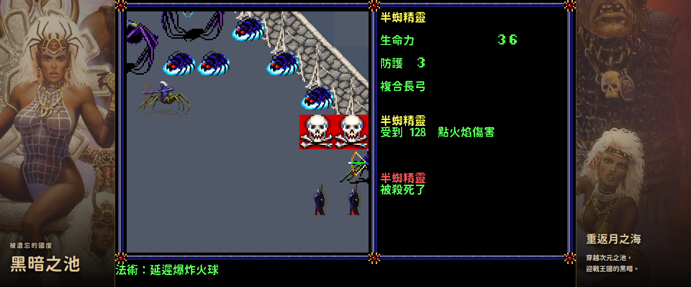

### 怪物 HD 素材

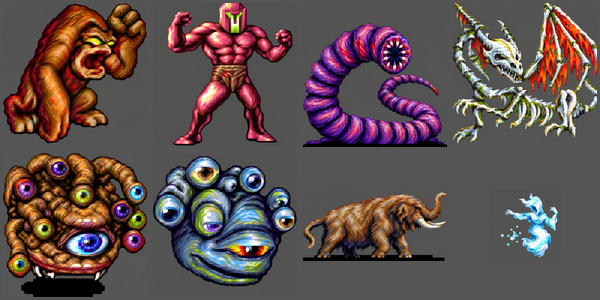

上圖是八張重繪素材的原尺寸拼圖，並非新增遭遇截圖。
完整原版對照與提示詞見[HD審閱頁](review/hd/README.md)，拼圖來源與雜湊見[預覽紀錄](docs/screenshots/monster-hd-preview.json)。

### 地下城地形 HD 素材

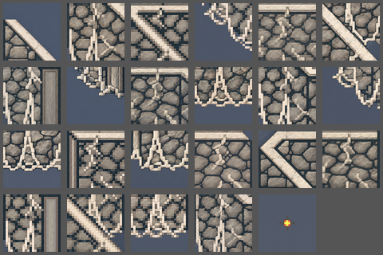

上圖是第5組新增23張重畫素材的原尺寸拼圖，並非新增戰鬥截圖。純色背景格保留原色，既有兩張石牆沿用。
原版並列、提示詞與驗收見[地形審閱頁](review/hd/b26-terrain/README.md)，拼圖來源見[預覽紀錄](docs/screenshots/dungeon-terrain-hd-preview.json)。

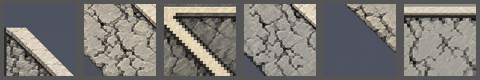

第4組新增六張72×72重繪素材，上圖保留成品原始尺寸。已接入條件式辨識並通過正常DEMO回歸；尚未在正常遭遇中觀測的來源仍依完整色號與色盤條件選用。
原版對照與提示詞見[本批審閱頁](review/hd/b27-terrain/README.md)，[接入驗收](docs/re/017-b27-runtime.json)與[拼圖來源](docs/screenshots/dungeon-terrain-bank4-hd-preview.json)另列。

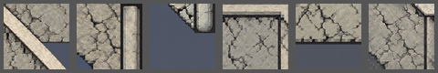

第4組第6–11格另有六張原尺寸重繪素材，包含石牆、牆角與端點。已接入並通過正常DEMO回歸，原版狀態與客體檔案一致、閃現0；上圖是素材拼圖，並非新增遭遇截圖。
原版對照與完整提示詞見[b28審閱頁](review/hd/b28-terrain/README.md)，[接入驗收](docs/re/017-b28-runtime.json)與[拼圖來源](docs/screenshots/dungeon-terrain-bank4-b28-hd-preview.json)另列。

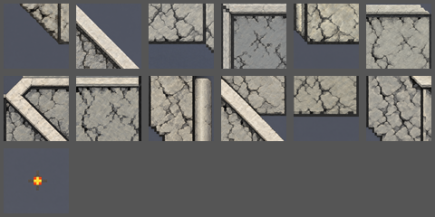

新增13張包含斜牆、轉角、端點與小光點，上圖是成品原尺寸拼圖。第4組25張圖樣已補齊，純色第22格維持原版；正常DEMO增量驗收通過、閃現0，未觀測正常遭遇仍未知。
原版並列與完整提示詞見[b29審閱頁](review/hd/b29-terrain/README.md)，[接入驗收](docs/re/017-b29-runtime.json)與[拼圖來源](docs/screenshots/dungeon-terrain-bank4-b29-hd-preview.json)另列。

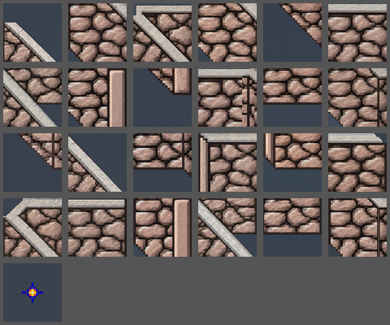

第3組25張重繪素材保留粉褐石塊、灰色壓頂與藍色小光點，純色格維持原色。上圖是成品原尺寸拼圖；已接入並通過正常DEMO增量驗收、閃現0，未觀測正常遭遇仍未知。
原版並列、來源變體與完整提示詞見[b30審閱頁](review/hd/b30-terrain/README.md)，[接入驗收](docs/re/017-b30-runtime.json)與[拼圖來源](docs/screenshots/dungeon-terrain-bank3-hd-preview.json)另列。

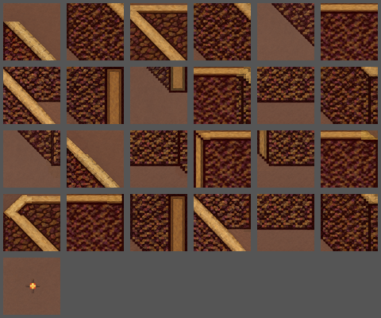

第2組25張重繪素材保留褐色地面、赭色邊梁、暗紅褐石材與中央小光點。上圖是成品原尺寸拼圖，純色格維持原色。
已接入並通過正常DEMO增量驗收、閃現0；未觀測正常遭遇仍未知。原版並列與內建生圖提示詞見[b31審閱頁](review/hd/b31-terrain/README.md)，[接入驗收](docs/re/017-b31-runtime.json)及[拼圖來源](docs/screenshots/dungeon-terrain-bank2-hd-preview.json)另列。

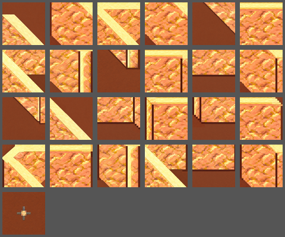

第1組25張重繪保留橘粉石材、淡黃邊梁與褐色地面。上圖是成品原尺寸拼圖，純色格維持原色。
來源診斷、正常DEMO與乾淨Git重建均通過，閃現0；未觀測正常遭遇仍未知。原版並列與內建生圖提示詞見[b32審閱頁](review/hd/b32-terrain/README.md)，[接入及重建收據](docs/re/017-b32-runtime.json)、[拼圖來源](docs/screenshots/dungeon-terrain-bank1-hd-preview.json)另列。

### 地下城第6組地形

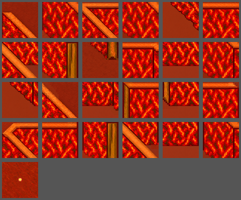

保留原版鮮紅紋理、橘色邊梁與磚紅地面。上圖以成品72×72原尺寸拼排，純色格保留原色。
六組地下城來源共156格已逐一核對，150張非純色圖樣都有HD，六格純色不重畫。
來源診斷、正常DEMO與乾淨Git重建通過，閃現0；未觀測正常遭遇仍未知。
原版並列與內建生圖提示詞見[b33審閱頁](review/hd/b33-terrain/README.md)，[驗收收據](docs/re/017-b33-runtime.json)與[拼圖來源](docs/screenshots/dungeon-terrain-bank6-hd-preview.json)另列。

### 野外森林地形

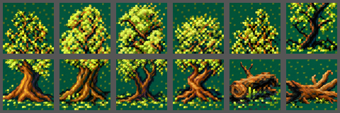

保留原版黃綠樹葉、褐色樹幹與深綠地面。上圖是12張72×72成品的原尺寸拼圖。
來源診斷、正常DEMO與乾淨Git重建通過，閃現0；正常野外遭遇尚未觀測。
原版並列與內建生圖提示詞見[b34審閱頁](review/hd/b34-wild-terrain/README.md)，[驗收收據](docs/re/017-b34-runtime.json)與[拼圖來源](docs/screenshots/wild-terrain-bank0-first-hd-preview.json)另列。

### 森林組水岸、岩石與家具

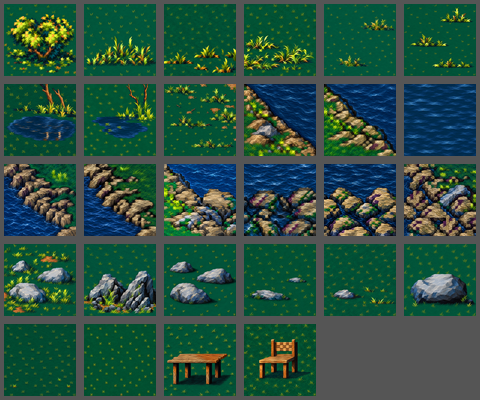

新增28張補齊本組40張，保留深綠地面、藍色水面、灰褐岩石與木製家具。上圖以72×72成品原尺寸拼排。
執行期抽驗六類代表素材及一條正常DEMO通過，閃現0；正常野外遭遇尚未觀測。
原版並列與內建生圖提示詞見[b35審閱頁](review/hd/b35-wild-terrain/README.md)，[抽驗收據](docs/re/017-b35-runtime.json)與[拼圖來源](docs/screenshots/wild-terrain-bank0-rest-hd-preview.json)另列。

### 野外第2組地形

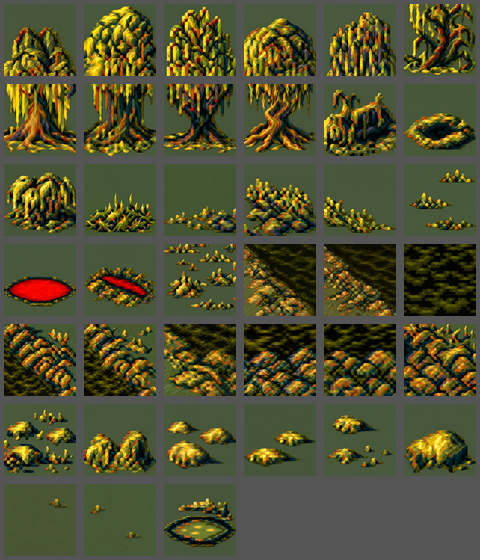

39張保留原版金黃、橄欖綠與深色裂隙，紅色池另保留原色。上圖以72×72成品原尺寸拼排，純色第38格維持原版。
六個固定代表樣本及一條正常DEMO抽驗通過，閃現0；正常野外遭遇尚未觀測。
原版並列與內建生圖提示詞見[b36審閱頁](review/hd/b36-wild-terrain/README.md)，[抽驗收據](docs/re/017-b36-runtime.json)與[拼圖來源](docs/screenshots/wild-terrain-bank2-hd-preview.json)另列。

### 野外第1組地形

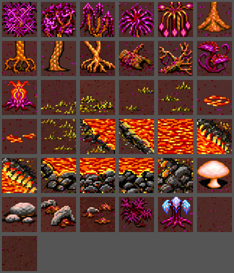

37張成品涵蓋40個來源，保留原版洋紅、橘黃、灰色邊界與深褐底色。上圖按72×72成品原尺寸拼排。
六個固定來源樣本及同程式新舊主題的正常DEMO抽驗通過，閃現0；正常野外遭遇尚未觀測。
原版並列、重複來源與提示詞見[b37審閱頁](review/hd/b37-wild-terrain/README.md)，[抽驗收據](docs/re/017-b37-runtime.json)與[拼圖來源](docs/screenshots/wild-terrain-bank1-hd-preview.json)另列。

### 戰鬥特效 HD 素材

這是六張 72×72 成品的原尺寸素材預覽。特效依原版完整來源與獨立色盤辨識，
有位置歧義時保留原版。原版並列與提示詞見[特效審閱頁](review/hd/b38-effects/README.md)。
預覽來源與雜湊見[素材清單](docs/screenshots/combat-effects-hd-preview.json)。

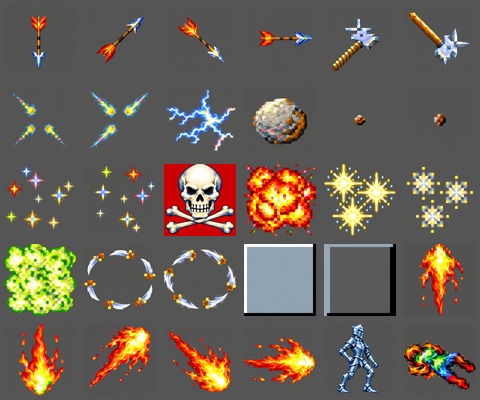

上圖同樣保留 72×72 成品原尺寸。全 44 個特效來源可對應到 36 張素材，
包含六個相同來源與兩個水平鏡像共用；來源對照與提示詞見[完整特效審閱](review/hd/b39-effects/README.md)，
拼圖來源見[預覽清單](docs/screenshots/combat-effects-complete-hd-preview.json)。

| 原版骷髏特效，3 倍 | HD 特效，3 倍 |
|---|---|
|  |  |

兩圖取自相同輸入的正常 DEMO，保留截圖原始像素。HD 差異只在這個特效矩形內，
來源與驗證範圍見[正常收據](docs/re/017-b38-play.json)及[截圖清單](docs/screenshots/combat-effect-runtime.json)。

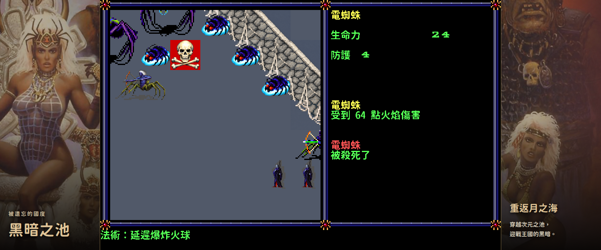

### 遭遇圖與距離

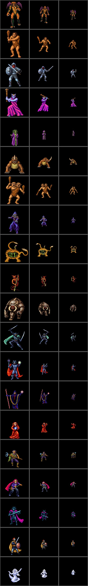

二十組各有近、中、遠三張264×264成品。上圖保留成品原尺寸與留白，是素材拼圖。
與下方既有素材合計29組87張；六類代表來源已抽驗，尚未遇到的正常事件與位置保留未知。
原版並列、提示詞與驗收雜湊見[完整素材審閱頁](review/hd/b43-encounter/README.md)，[預覽來源](docs/screenshots/encounter-b43-hd-preview.json)及[接入與乾淨重建收據](docs/re/017-b43-runtime.json)另列。

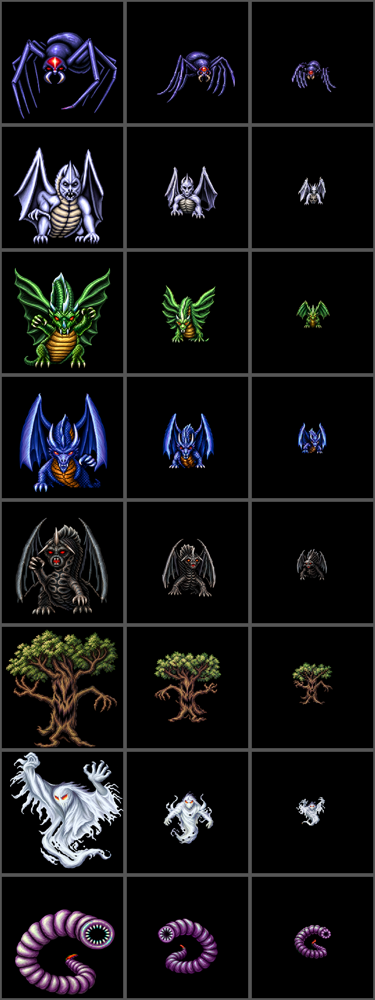

八組各有近、中、遠三張264×264成品，保留原版大小與留白。上圖是原尺寸素材拼圖，並非新增正常遭遇截圖。
六類來源的前景、透明區、直接合成與失配回退已抽驗；未觀測的正常事件仍未知。
原版並列與內建生圖提示詞見[本批審閱頁](review/hd/b42-encounter/README.md)，[預覽來源](docs/screenshots/encounter-b42-hd-preview.json)及[接入與重建收據](docs/re/017-b42-runtime.json)另列。

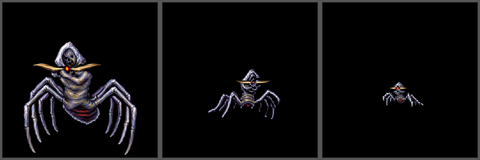

三張 264×264 成品保留各自的大小與留白，上圖是素材預覽。
HD 只覆蓋來源的非零前景，地下城背景仍可從腿部與身體間看見。
原版並列與內建生圖提示詞見[遭遇圖審閱頁](review/hd/b41-encounter/README.md)，[預覽來源](docs/screenshots/encounter-041-hd-preview.json)另列。

| 原版遭遇圖，3 倍 | HD 遭遇圖，3 倍 |
|---|---|
| 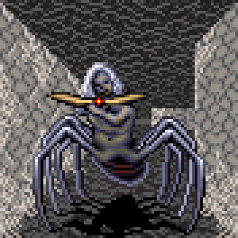 | 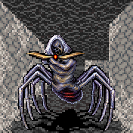 |

兩圖取自相同輸入的正常 DEMO，保留截圖原始像素。近景與遠景都已核對完整成品前景，
透明區及框外差異為 0；中景正常事件尚未觀測。[正常比較](docs/re/017-b41-play.json)及[截圖來源](docs/screenshots/encounter-041-runtime.json)另列。

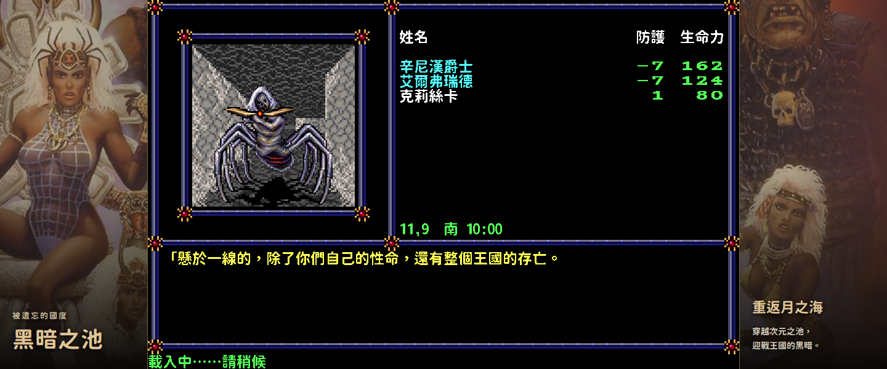

### 天空與地下城背景

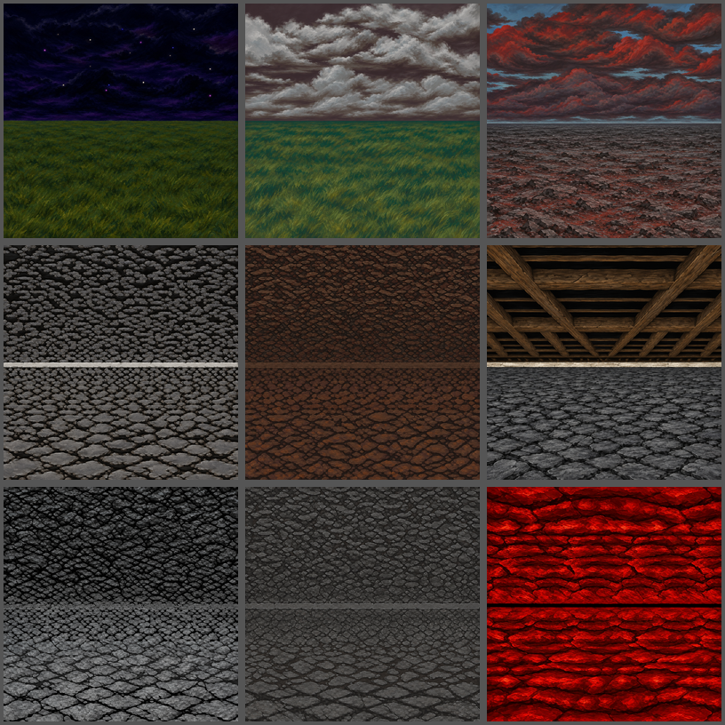

上圖是九張 264×264 成品的原尺寸拼圖，保留各種石材、木樑、夜空、陰天與紅雲的原版配色。
這是素材預覽；來源診斷及正常 DEMO 回歸通過，完整背景的正常事件與遮擋仍未知。
原版並列與內建生圖提示詞見[背景審閱頁](review/hd/b40-background/README.md)，[預覽來源](docs/screenshots/background-hd-preview.json)及[抽驗範圍](docs/re/017-b40-runtime.json)另列。

### 菲蘭街景

| 原版菲蘭街景 | 繁中與 HD 街景 |
|---|---|
|  | 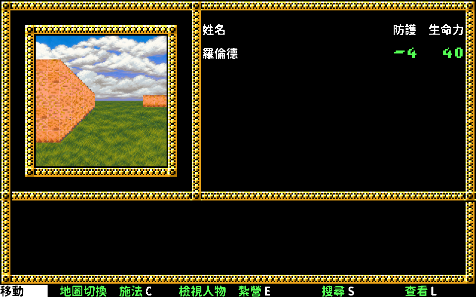 |

上圖取自正常冷啟動讀檔後的同一地點。17種牆面與天空、地面組成121格街景，
4,800格抽樣閃現為0，原版狀態及存檔一致；其他地點仍在製作。

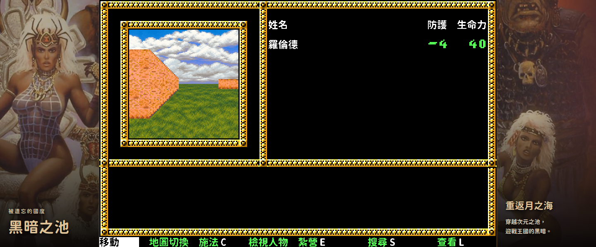

### 遊戲內地圖與攻略點

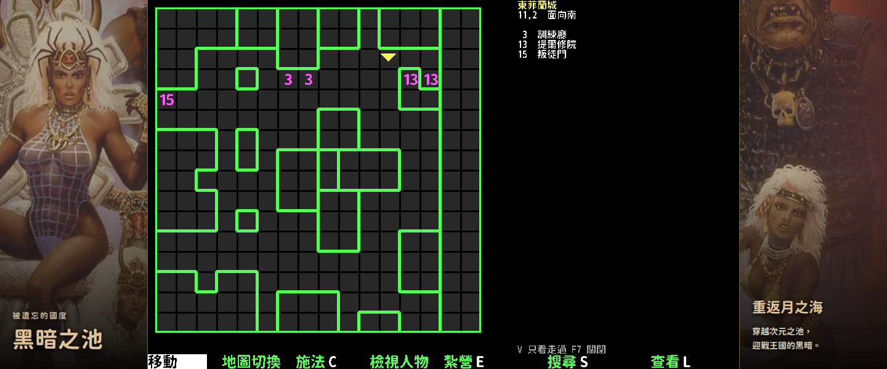

按 F7 開關地圖，可看隊伍位置、方向與攻略點。預設只顯示走過的區域，按 V 切換全圖。
上圖為東菲蘭的全圖模式，標出訓練廳、提爾修院與叛徒門，取自正常冷啟動讀檔後的實際操作。

### 上方工具列

滑鼠移到視窗頂端即可展開工具列，切換顯示、開啟手札、攻略、地圖及其他選項。灰色項目目前停用。

| 速度選單 | 字級選單 |
|---|---|
| 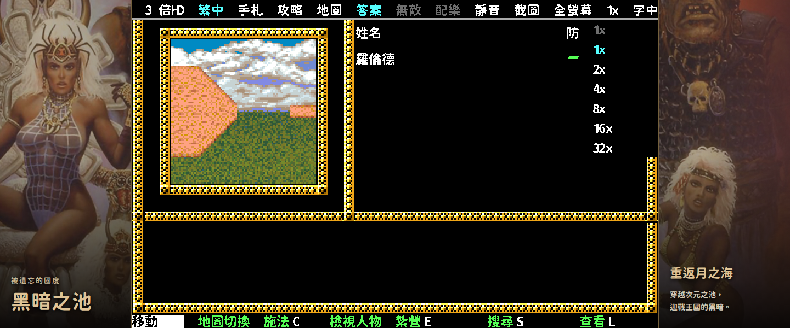 | 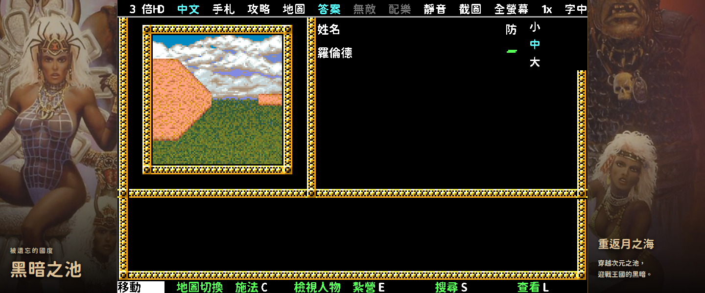 |

速度設定是上限，下拉選單第一列顯示實際倍率。程式會依模擬耗時與畫面更新負載降低實際倍率，最低保留 1x。

工具列可選小、中、大，記住上次選擇。3 倍使用 16／22／24 像素字模，
2 倍使用 12／16／16 像素字模；不改遊戲文字大小。下圖保留截圖原始像素，
12、22 像素由源泉圓體直接產生。

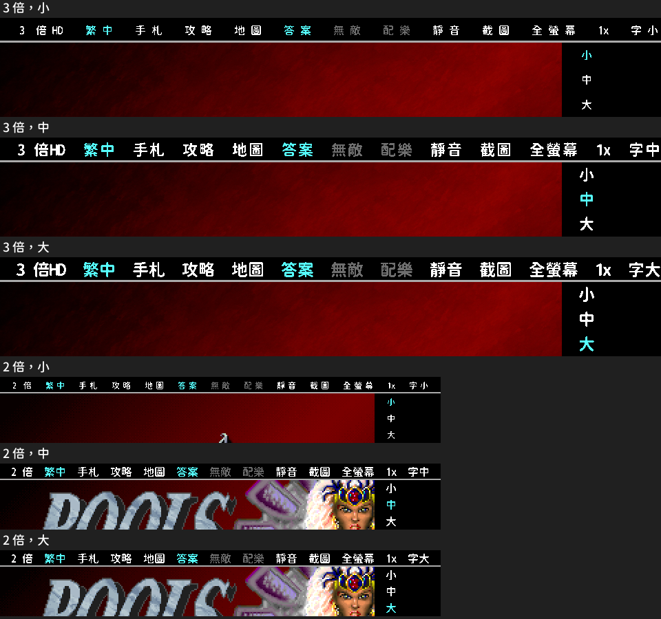

### 左右海報

固定加寬保留中央遊戲尺寸。3 倍為 1440×600，中央 960×600；2 倍為 960×400，中央 640×400。
下列較早的視窗截圖使用[官方商店的原版插畫](https://store.steampowered.com/app/1904522/Pools_of_Darkness/)；目前採用已核准的B版HD海報，範圍見[HD patch驗收](docs/re/033-hd-patch-runtime.json)。
目前開發版的標題與文案跟隨語系，F8依繁中／英文／日文／韓文／簡中循環，F12切回英文原版。

| 英文原版模式與英文海報 | 2 倍畫面與完整海報 |
|---|---|
|  |  |

這些是實際遊戲視窗截圖，來源與驗證範圍見[海報紀錄](docs/re/015-side-posters.md)。

## 執行與文件

目前開發入口為 `tools/play-smoke.sh`，使用 Docker 與 dosgolem。需自備原版遊戲資料；本儲存庫不附原版遊戲或可直接遊玩的完整包。
開發工作樹、字型來源及本機輸入的準備位置見 [CONTEXT.md](CONTEXT.md)。

開場選單按 `P` 進入遊戲，按 `D` 播放示範，選單不會自行逾時。
示範中按一般遊戲鍵可中止並回到選單，包含戰鬥途中；F2、F12 等前端快捷鍵保留呈現操作。
[中斷與重播驗收](docs/spec/018-demo-control.md#demo-conformed)另列。

目前開發版可按 `F1` 或工具列的「無敵」切換我方無敵，預設關閉。開啟時保護一般與戰鬥HP，阻擋健康惡化，移除已核對的失明、緩慢、麻痺、睡眠與中毒效果。治療與敵方照常；關閉後不補扣已擋下的傷害，玩家存檔會保留受保護後的結果。[抽驗範圍與限制](docs/spec/017-invincible.md)另列。

這張英文DEMO截圖的工具列「God」亮起。原版仍顯示傷害訊息，HP寫入由守衛保護。

戰鬥中的HD特效會保留透明背景，依實際可見來源處理地形與怪物的遮擋。既有10,500格正常DEMO抽驗的閃現量尺由19格降為0，原版狀態及127個客體檔案相同；其他事件仍待抽驗。[來源與驗證範圍](docs/re/030-hd-occlusion.md)另列。

現況見 [CONTEXT.md](CONTEXT.md)，工作項目見
[GitHub Issues](https://github.com/wicanr2/pools-of-darkness-cht/issues)，協作規則見 [AGENTS.md](AGENTS.md)。
規格與來源證據分別見[規格索引](docs/spec/000-index.md)及[研究索引](docs/re/README.md)。

## 授權

本專案自有的程式與文件採 [RRSAL-1.0](LICENSE)（source-available，非商業免費、商業另洽）。
授權不涵蓋原版遊戲素材與中文說明書，使用者須自備合法取得的原版。
README 與 HD 審閱頁中的原版圖片僅依本專案現有私人儲存庫展示範圍保存，不是可散布素材。
本專案與 SSI、TSR 及相關權利人沒有隸屬關係。
