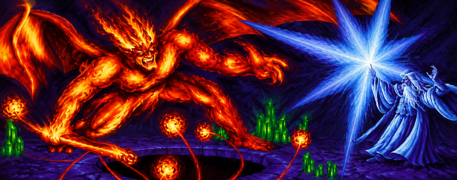
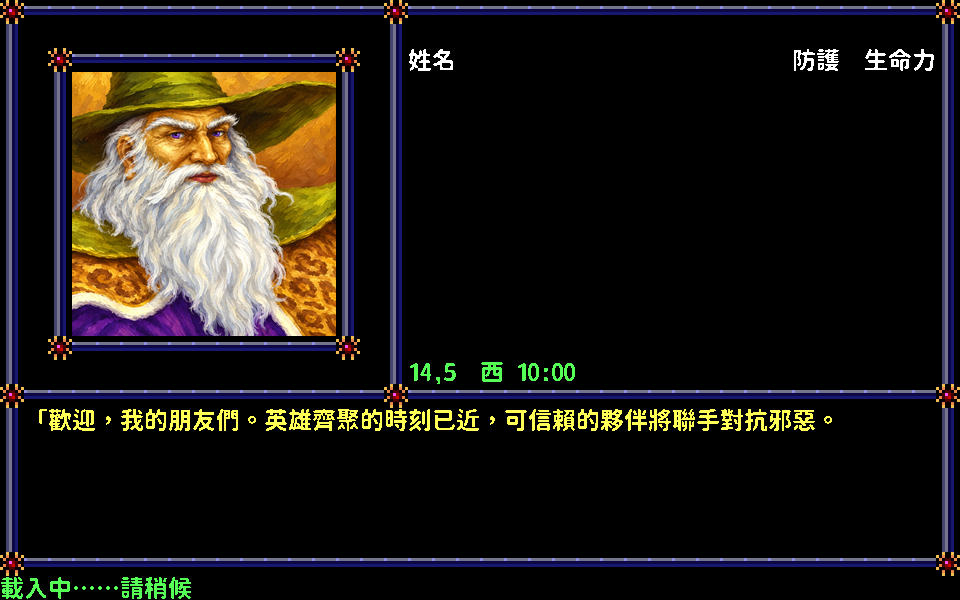
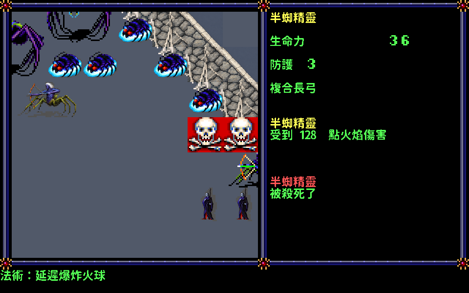
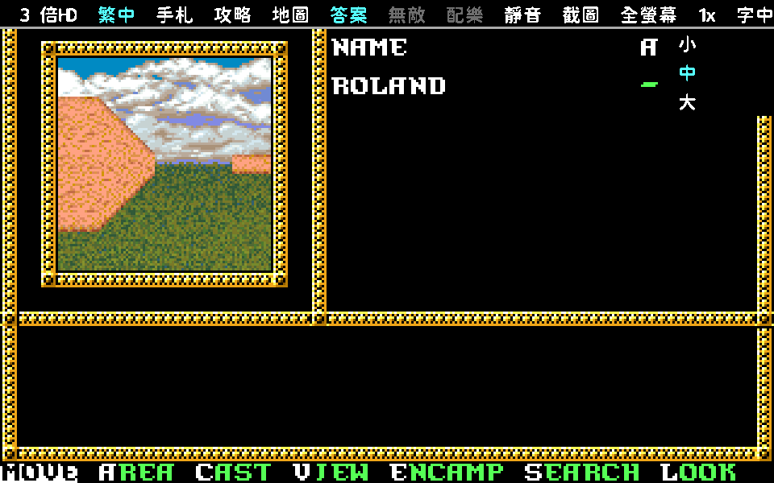

# 黑暗之池（Pools of Darkness）繁體中文化與 HD

以 [dosgolem](https://github.com/wicanr2/dosgolem) 執行 SSI DOS 版《Pools of Darkness》，
在執行期攔截原版輸出並覆繪繁體中文，之後再加入 HD 重繪圖。原版遊戲、規則與存檔保持原樣，需自備原版。

本專案另修正軟體世界珍藏版說明書的錯譯，並把修正後的手札放進遊戲，劇情引用時直接開啟。

## 重返菲蘭城

十年來，你們走遍王國，挫敗邪惡勢力的陰謀。如今船隻駛入月之海的港灣，昔日滿目瘡痍的菲蘭城已重建高塔與街市。
擊敗泰蘭特拉克斯的英雄回到成名之地，迎接你們的似乎是一段難得的太平日子。

但班恩並未放棄。籠罩月之海的黑暗即將把隊伍帶離熟悉的街道，穿過次元傳送池，迎向龍族、黑暗精靈與異界的敵人。
這場旅程從重返家園開始，最後要面對的，是威脅整個王國的力量。

本作是 SSI 於 1991 年推出的 AD&D《被遺忘的國度》角色扮演遊戲，也是這套四部曲的第四作。
玩家組成冒險隊伍，探索城鎮與地下城、閱讀手札線索，並在回合制戰鬥中安排移動、武器與法術。
故事背景整理自 [SSI《冒險者手冊》導言](https://www.mocagh.org/ssi/pod-journal.pdf)與本作開場文字；
原文來源與版本見[參考文件紀錄](docs/re/002-reference-sources.md)。

## 本專案做了什麼

遊戲仍由 dosgolem 執行原版 DOS 程式。繁體中文與 HD 透過呈現層覆繪，原版規則、資料判定、亂數與存檔保持原樣。
手札採用經英文原文校正的珍157 譯文，事件引用時直接顯示；另有遊戲內攻略與地圖疊層，減少來回翻閱紙本的需要。

繁中已驗證冷啟動、建角、存讀檔、查驗題與部分探索路徑。人物 HD 主題的 81 個狀態已完成，去重後 78 項，
已接入並做正常 DEMO 抽樣。七張 BIGPIC 已重畫，執行期接入仍在驗證；其他圖族尚在製作。
戰鬥已有四十二個怪物狀態候選與兩張石牆接入，通過正常冷啟動、倍率與原版切換抽樣。
尚未遇到的怪物狀態依完整原版前景辨識，驗收範圍見[研究017](docs/re/017-vga-battle-hd.md)。
開場封面、世界標誌與製作名單已接入，可用 F8 切換繁中與英文。
菲蘭起點的天空、地面與牆面也已接入，完整讀檔抽樣通過。
完整現況與驗證範圍見 [CONTEXT.md](CONTEXT.md)。

## 畫面介紹

### 遊戲封面：原版與 HD

| 原版封面 | 繁中 HD 實際畫面 |
|---|---|
|  |  |

左圖由 `TITLE.DAX` 第 2 塊解碼，與正常冷啟動原版畫面逐像素一致；右圖是實際遊戲截圖。
HD 採完整藍紫色禮服，保留女王、王冠與寶座構圖。標題文字與美術分離，F8 可切為[英文 HD 封面](docs/screenshots/game-cover-hd-en.png)。
另見[含兩側海報的完整封面視窗](docs/screenshots/game-cover-window.png)。三張開場圖與語系切換的原版狀態比較、零閃現範圍見[開場驗收](docs/re/014-vga-hd.md#開場與英文正常路徑驗收)。

### 原版 BIGPIC 與 HD 重畫

| 原版 BIGPIC | HD 重繪預覽 |
|---|---|
|  |  |
|  |  |
|  |  |

左側從本作 `BIGPIC1.DAX` 區塊 240、243、246 解碼，以 3 倍最近鄰顯示；右側是依原圖手繪風格重畫的 912×360 素材。
這一批畫風已確認，上表為素材預覽。
來源與 SHA-256 見[展示圖清單](docs/screenshots/manifest.json)，完整並列與提示詞見 [HD 審閱頁](review/hd/README.md)。
HD 製作與接入進度由 [#10](https://github.com/wicanr2/pools-of-darkness-cht/issues/10) 追蹤。

### 繁中與 HD 實際畫面

| 原版 DOS 畫面 | 繁中與 HD，3 倍顯示 |
|---|---|
|  |  |
|  |  |

以上是 dosgolem 執行 DEMO 的 960×600 畫面。右側繁中與 HD 另以正常冷啟動核對，像素完全一致。
兩張小圖已接入；同狀態比較確認 HD 差異只落在原版圖框，原版記憶體、暫存器、色號與存檔一致。
目前展示範圍為開場 DEMO，冷啟動到戰鬥的抽樣路線閃現為 0；其餘圖族仍在製作與驗證。

| 原版戰鬥 | 繁中與首批戰鬥 HD |
|---|---|
|  |  |

本批包含半蜘蛛精靈、吸血鬼法師、電蜘蛛及兩張石牆。完整冷啟動 7,400 格的閃現為 0，
HD、無 HD、F12 原版及 2 倍四路的 CPU、記憶體、色號、色盤與 127 個 DOS 檔案一致。
另見[含兩側海報的完整戰鬥視窗](docs/screenshots/demo-battle-window.png)與[驗收範圍](docs/re/017-vga-battle-hd.md)。

### 菲蘭街景

| 原版菲蘭街景 | 繁中與 HD 街景 |
|---|---|
|  |  |

上圖取自正常冷啟動讀檔後的同一地點。17種牆面與天空、地面組成121格街景，
4,800格抽樣閃現為0，原版狀態及存檔一致；其他地點仍在製作。
另見[含兩側海報的街景視窗](docs/screenshots/street-window.png)。

### 遊戲內地圖與攻略點

按 F7 開關地圖，可看隊伍位置、方向與攻略點。預設只顯示走過的區域，按 V 切換全圖。
上圖為東菲蘭的全圖模式，標出訓練廳、提爾修院與叛徒門，取自正常冷啟動讀檔後的實際操作。

### 上方工具列

滑鼠移到視窗頂端即可展開工具列，切換顯示、開啟手札、攻略、地圖及其他選項。灰色項目目前停用。
另見[完整視窗](docs/screenshots/toolbar-window.png)、[速度選單](docs/screenshots/toolbar-speed-menu.png)與[字級選單](docs/screenshots/toolbar-font-menu.png)。

### 左右海報

固定加寬保留中央遊戲尺寸。3 倍為 1440×600，中央 960×600；2 倍為 960×400，中央 640×400。
兩側採用[官方商店的原版插畫](https://store.steampowered.com/app/1904522/Pools_of_Darkness/)，
標題與文案跟隨目前語系，F8 切換繁中／英文，F12 切回英文原版。
另見[英文原版模式](docs/screenshots/demo-poster-en.png)與[2 倍畫面](docs/screenshots/demo-poster-2x.png)。
這些是實際遊戲視窗截圖，來源與驗證範圍見[海報紀錄](docs/re/015-side-posters.md)。

## 執行與文件

目前開發入口為 `tools/play-smoke.sh`，使用 Docker 與 dosgolem。需自備原版遊戲資料；本儲存庫不附原版遊戲或可直接遊玩的完整包。
開發工作樹、字型來源及本機輸入的準備位置見 [CONTEXT.md](CONTEXT.md)。

現況見 [CONTEXT.md](CONTEXT.md)，工作項目見
[GitHub Issues](https://github.com/wicanr2/pools-of-darkness-cht/issues)，協作規則見 [AGENTS.md](AGENTS.md)。
規格與來源證據分別見[規格索引](docs/spec/000-index.md)及[研究索引](docs/re/README.md)。

## 授權

本專案自有的程式與文件採 [RRSAL-1.0](LICENSE)（source-available，非商業免費、商業另洽）。
授權不涵蓋原版遊戲素材與中文說明書，使用者須自備合法取得的原版。
README 與 HD 審閱頁中的原版圖片僅依本專案現有私人儲存庫展示範圍保存，不是可散布素材。
本專案與 SSI、TSR 及相關權利人沒有隸屬關係。
