# HD 圖片審閱

風格 B，沿用使用者確認的奇幻手繪與原版配色。
本頁為素材對照；執行期覆蓋範圍見[主審閱入口](../README.md)。

| 來源 key／原版 3 倍 | HD 3 倍 |
|---|---|
| pic1-002  |  |
| pic1-007@0  |  |
| pic1-011  |  |
| pic1-012  |  |
| pic1-013  |  |
| pic1-014  |  |
| pic1-026@0  |  |
| pic1-031@0  |  |
| pic1-032  |  |
| pic1-035  | 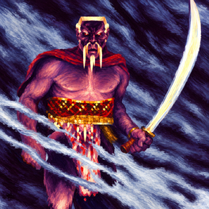 |
| pic1-038  |  |
| pic1-043@0  |  |
| pic1-044@0  |  |
| pic1-047@0  |  |
| pic1-062  |  |
| pic1-070  |  |
| pic1-077  |  |
| pic1-078  |  |
| pic1-085  |  |
| pic1-086  |  |
| pic1-112  | 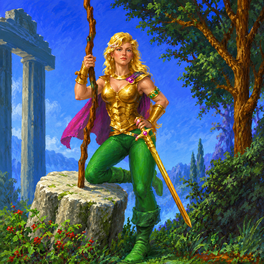 |
| pic1-113  |  |
| pic1-114  | 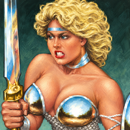 |
| pic1-115  |  |
| pic1-116  | 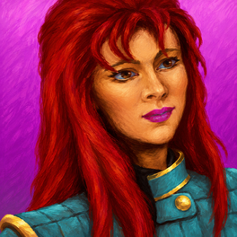 |
| pic1-128  |  |
| pic1-129  |  |
| pic1-130  | 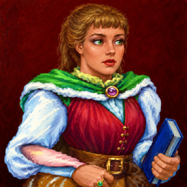 |
| pic1-131  |  |
| pic1-132  |  |
| pic1-133  |  |
| pic1-134  |  |
| pic1-135 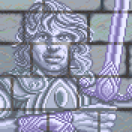 | 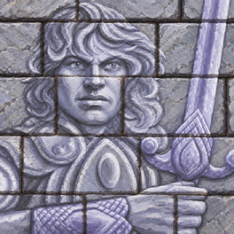 |
| pic1-136  |  |
| pic1-137@0  |  |
| pic1-138  | 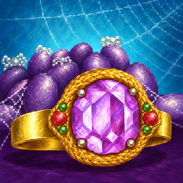 |
| pic1-139 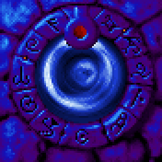 | 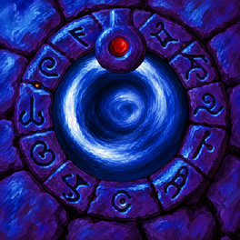 |
| pic1-140 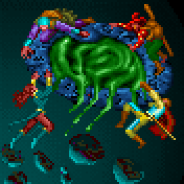 | 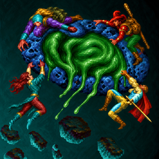 |
| pic1-141  | 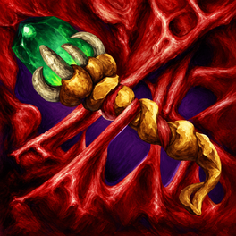 |
| pic1-142  | 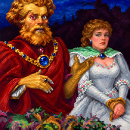 |
| pic1-143@0 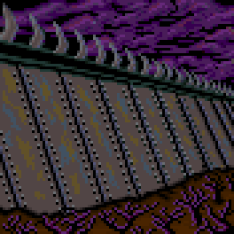 | 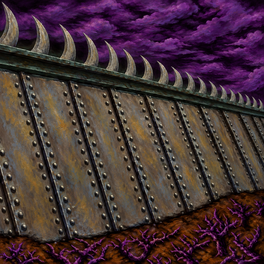 |
| pic1-144  |  |
| pic1-145  |  |
| pic1-146  |  |
| pic1-147  |  |
| pic1-148  |  |
| pic1-149  |  |
| pic1-150  |  |
| pic1-151  |  |

完整來源、提示詞與 SHA-256 見 [manifest.json](manifest.json)。
