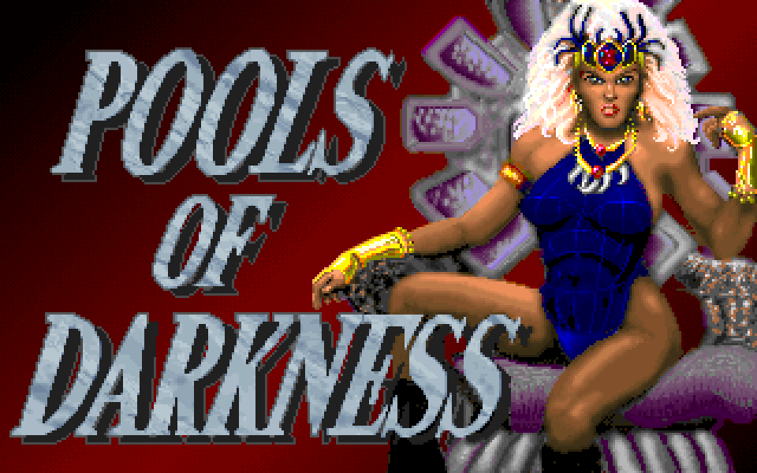
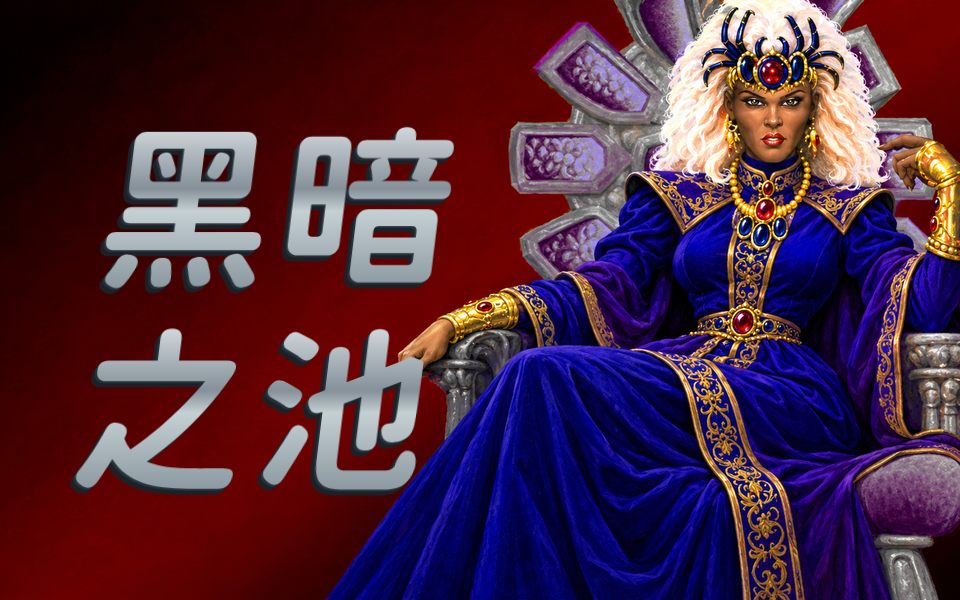

# 遊戲封面原版與 HD

Issue：[#25](https://github.com/wicanr2/pools-of-darkness-cht/issues/25)。來源為本作 `TITLE.DAX` 區塊 2，320×200。
使用者於 2026-10-24 確認完整藍紫色禮服版。原姿勢、王冠、寶座與構圖保留；服裝覆蓋為明確核准的例外。

| 原版 3 倍 | 繁中 HD |
|---|---|
|  |  |

另見[英文 HD](cover-en.png)。標題由 `text/cover.<語系>.tsv` 渲染，沒有把英文烘入共用插畫。
表內素材與正常冷啟動的現行封面逐像素一致，F8繁中／英文、F2與F12已驗。執行期收據由[#26](https://github.com/wicanr2/pools-of-darkness-cht/issues/26)與研究014保存。
數值全圖比較包含已核准服裝與語系文字差異，不冒稱重畫與原版逐像素一致。
原始生成圖、完整提示詞、服裝核准、字型及輸出 SHA-256 見 [manifest.json](manifest.json)。
產生入口為 `tools/cover_prototype.py` 與 `tools/poster_capture.mjs` 的 cover 模式。
來源紀錄見[研究 014](../../../docs/re/014-vga-hd.md)，只供目前私人專案審閱。
