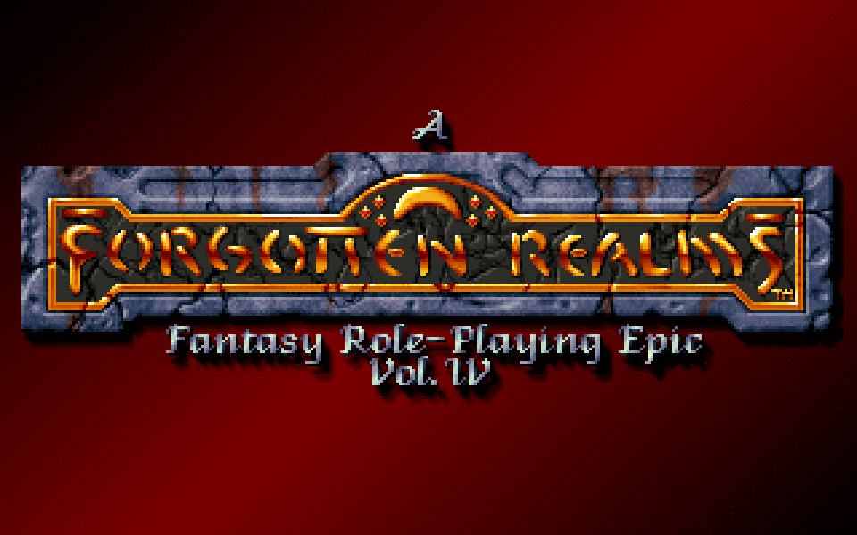
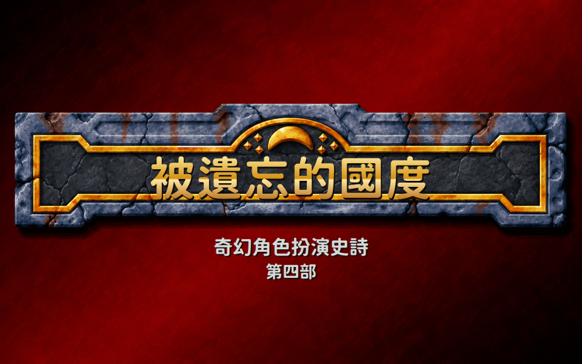
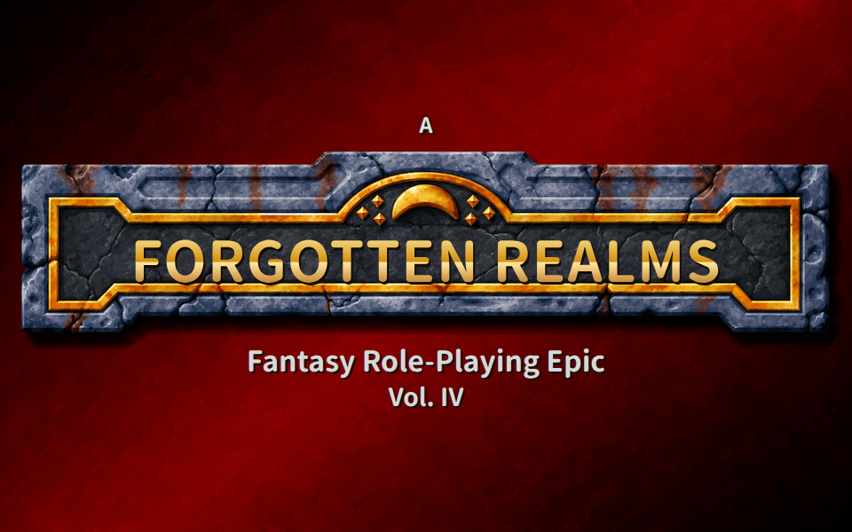
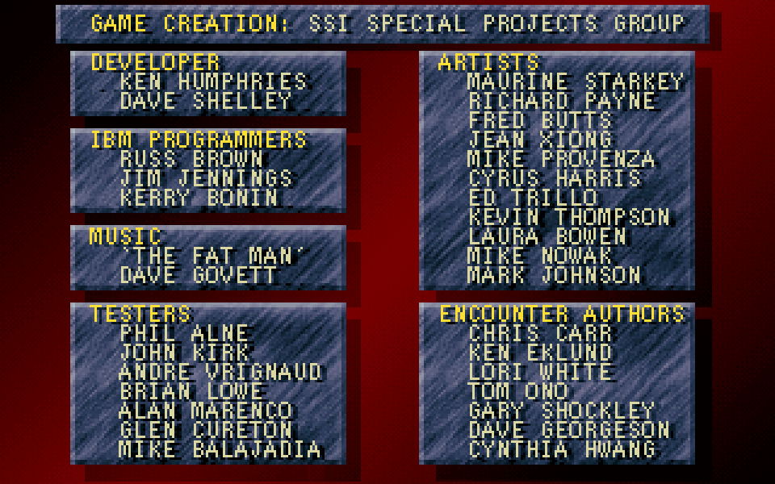
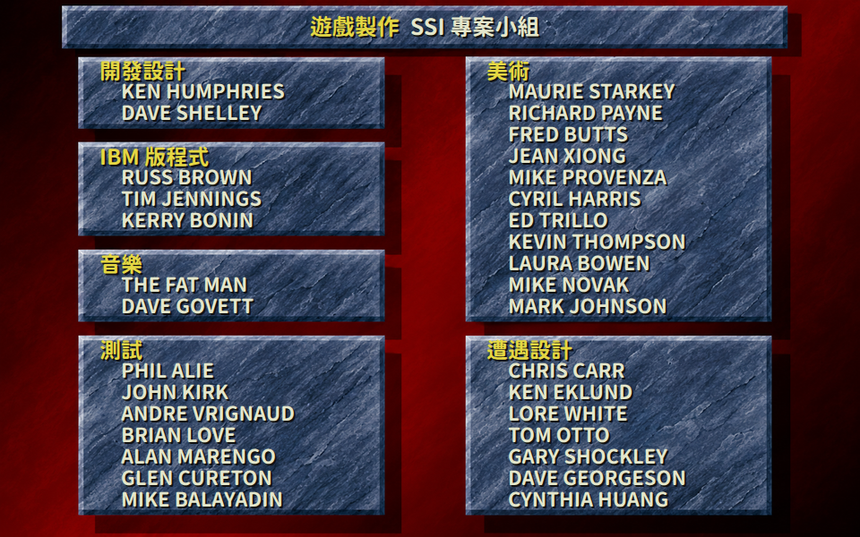
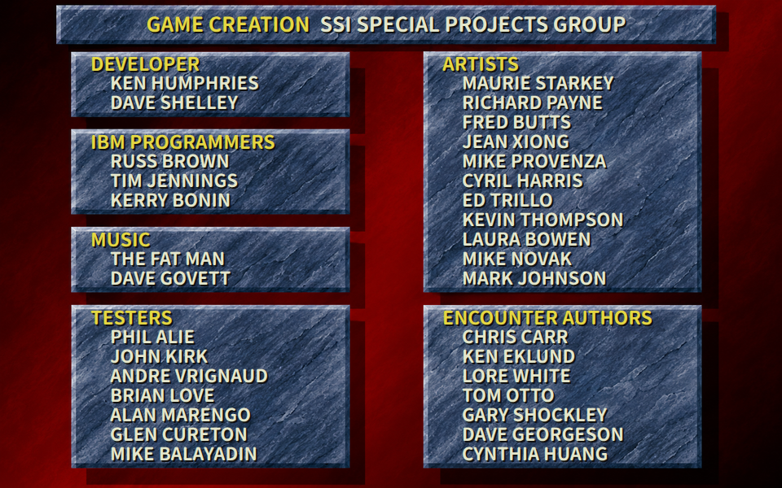

# 開場標誌與製作名單

原版來源為TITLE第1、3塊。底圖以內建生圖重畫，所有文字由正式語系表及源泉圓體Bold渲染。
人名依原版保留英文。表內素材已與正常冷啟動及F8語系切換逐像素核對，接入範圍由[#26](https://github.com/wicanr2/pools-of-darkness-cht/issues/26)追蹤。

| 原版 | 繁中HD | 英文HD |
|---|---|---|
|  |  |  |
|  |  |  |

來源、完整提示詞、底圖、正式文案及字型雜湊見[manifest.json](manifest.json)。
文字邊界見各圖的`layout.json`，擷取條件見[capture.json](capture.json)。
女王封面沿用[已核准禮服版](../b06-cover/README.md)。主審閱入口見[HD索引](../README.md)。
正常冷啟動與零閃現證據見[研究014](../../../docs/re/014-vga-hd.md#開場與英文正常路徑驗收)。
