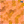
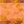
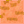
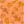
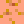
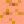

# HD 圖片審閱

風格 B，沿用使用者確認的奇幻手繪與原版配色。
本頁為素材對照；執行期覆蓋範圍見[主審閱入口](../README.md)。

| 來源 key／原版 3 倍 | HD 3 倍 |
|---|---|
| 8x8d1-001@21  |  |
| 8x8d1-001@32  |  |
| 8x8d1-001@36  |  |
| 8x8d1-001@37  |  |
| 8x8d1-001@38  |  |
| 8x8d1-001@40  |  |
| 8x8d1-001@41  |  |
| 8x8d1-001@42  |  |
| 8x8d1-001@43  |  |
| 8x8d1-001@44  |  |
| 8x8d1-001@46  |  |
| 8x8d1-001@47  |  |
| 8x8d1-001@55  |  |
| 8x8d1-001@60  |  |
| 8x8d1-001@61  |  |
| 8x8d1-001@62  |  |
| 8x8d1-001@193  |  |

完整來源、提示詞與 SHA-256 見 [manifest.json](manifest.json)。
