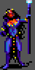
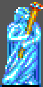
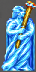

# HD 圖片審閱

風格 B，沿用使用者確認的奇幻手繪與原版配色。
本頁為素材對照；執行期覆蓋範圍見[主審閱入口](../README.md)。

| 來源 key／原版 3 倍 | HD 3 倍 |
|---|---|
| cpic1-019  |  |
| cpic1-147  |  |
| cpic1-020  |  |
| cpic1-148  |  |
| cpic1-021  |  |
| cpic1-149  |  |
| cpic1-022  |  |
| cpic1-150  |  |
| cpic1-023  |  |
| cpic1-151  |  |
| cpic1-024  |  |
| cpic1-152  |  |

完整來源、提示詞與 SHA-256 見 [manifest.json](manifest.json)。
