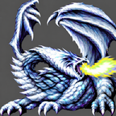
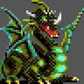
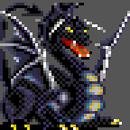
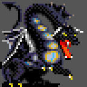

# HD 圖片審閱

風格 B，沿用使用者確認的奇幻手繪與原版配色。
本頁為素材對照；執行期覆蓋範圍見[主審閱入口](../README.md)。

| 來源 key／原版 3 倍 | HD 3 倍 |
|---|---|
| cpic1-025  |  |
| cpic1-153  |  |
| cpic1-026  |  |
| cpic1-154  |  |
| cpic1-027  |  |
| cpic1-155  |  |
| cpic1-028  |  |
| cpic1-156  |  |
| cpic1-029  |  |
| cpic1-157  |  |
| cpic1-030  |  |
| cpic1-158  |  |

完整來源、提示詞與 SHA-256 見 [manifest.json](manifest.json)。
