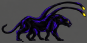
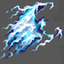
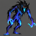

# HD 圖片審閱

風格 B，沿用使用者確認的奇幻手繪與原版配色。
本頁為素材對照；執行期覆蓋範圍見[主審閱入口](../README.md)。

| 來源 key／原版 3 倍 | HD 3 倍 |
|---|---|
| cpic1-050  |  |
| cpic1-178  |  |
| cpic1-051  |  |
| cpic1-179  |  |
| cpic1-052  |  |
| cpic1-180  |  |
| cpic1-053  |  |
| cpic1-181  |  |
| cpic1-054  |  |
| cpic1-182  |  |
| cpic1-055  |  |
| cpic1-183  |  |

完整來源、提示詞與 SHA-256 見 [manifest.json](manifest.json)。
