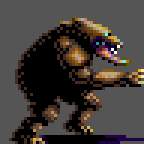

# HD 圖片審閱

風格 B，沿用使用者確認的奇幻手繪與原版配色。
本頁為素材對照；執行期覆蓋範圍見[主審閱入口](../README.md)。

| 來源 key／原版 3 倍 | HD 3 倍 |
|---|---|
| cpic1-068  |  |
| cpic1-196  |  |
| cpic1-069  |  |
| cpic1-197  |  |
| cpic1-070  |  |
| cpic1-198  |  |
| cpic1-071  |  |
| cpic1-199  |  |
| cpic1-072  |  |
| cpic1-200  |  |
| cpic1-073  |  |
| cpic1-201  |  |
| cpic1-074  |  |
| cpic1-202  |  |
| cpic1-075  |  |
| cpic1-203  |  |
| cpic1-076  |  |
| cpic1-204  |  |
| cpic1-077  |  |
| cpic1-205  |  |
| cpic1-078  |  |
| cpic1-206  |  |
| cpic1-079  |  |
| cpic1-207  |  |

完整來源、提示詞與 SHA-256 見 [manifest.json](manifest.json)。
