# HD 圖片審閱

風格 B，沿用使用者確認的奇幻手繪與原版配色。
本頁為素材對照；執行期覆蓋範圍見[主審閱入口](../README.md)。

| 來源 key／原版 3 倍 | HD 3 倍 |
|---|---|
| dungcom-005@0  |  |
| dungcom-005@1 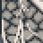 | 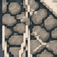 |
| dungcom-005@2  |  |
| dungcom-005@4  |  |
| dungcom-005@5  |  |
| dungcom-005@6  |  |
| dungcom-005@7  |  |
| dungcom-005@8  | 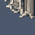 |
| dungcom-005@9 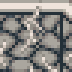 |  |
| dungcom-005@10 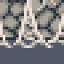 | 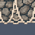 |
| dungcom-005@11 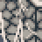 | 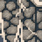 |
| dungcom-005@12  |  |
| dungcom-005@14  |  |
| dungcom-005@15  | 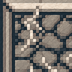 |
| dungcom-005@16 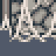 |  |
| dungcom-005@17  |  |
| dungcom-005@18  |  |
| dungcom-005@19  |  |
| dungcom-005@20  | 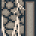 |
| dungcom-005@21  |  |
| dungcom-005@23 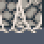 | 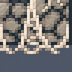 |
| dungcom-005@24 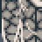 |  |
| dungcom-005@25  |  |

完整來源、提示詞與 SHA-256 見 [manifest.json](manifest.json)。
