# HD 圖片審閱

風格 B，沿用使用者確認的奇幻手繪與原版配色。
本頁為素材對照；執行期覆蓋範圍見[主審閱入口](../README.md)。

| 來源 key／原版 3 倍 | HD 3 倍 |
|---|---|
| dungcom-004@6 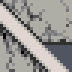 | 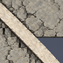 |
| dungcom-004@7 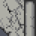 | 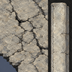 |
| dungcom-004@8 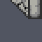 | 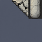 |
| dungcom-004@9 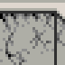 | 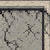 |
| dungcom-004@10 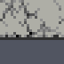 | 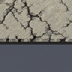 |
| dungcom-004@11 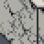 | 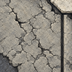 |

完整來源、提示詞與 SHA-256 見 [manifest.json](manifest.json)。
