# HD 圖片審閱

風格 B，沿用使用者確認的奇幻手繪與原版配色。
本頁為素材對照；執行期覆蓋範圍見[主審閱入口](../README.md)。

| 來源 key／原版 3 倍 | HD 3 倍 |
|---|---|
| dungcom-004@12 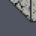 | 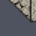 |
| dungcom-004@13 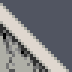 | 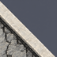 |
| dungcom-004@14 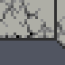 | 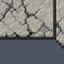 |
| dungcom-004@15 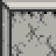 | 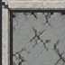 |
| dungcom-004@16 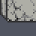 | 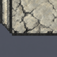 |
| dungcom-004@17 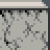 | 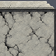 |
| dungcom-004@18 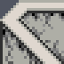 | 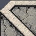 |
| dungcom-004@19 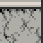 | 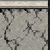 |
| dungcom-004@20 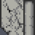 | 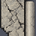 |
| dungcom-004@21 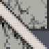 | 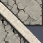 |
| dungcom-004@23 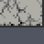 | 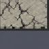 |
| dungcom-004@24 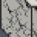 | 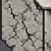 |
| dungcom-004@25  |  |

完整來源、提示詞與 SHA-256 見 [manifest.json](manifest.json)。
