# HD 圖片審閱

風格 B，沿用使用者確認的奇幻手繪與原版配色。
本頁為素材對照；執行期覆蓋範圍見[主審閱入口](../README.md)。

| 來源 key／原版 3 倍 | HD 3 倍 |
|---|---|
| dungcom-003@0 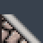 | 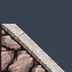 |
| dungcom-003@1 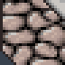 | 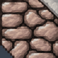 |
| dungcom-003@2 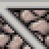 | 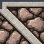 |
| dungcom-003@3 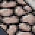 | 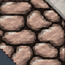 |
| dungcom-003@4  | 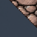 |
| dungcom-003@5 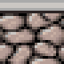 | 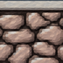 |
| dungcom-003@6  | 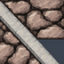 |
| dungcom-003@7 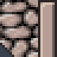 | 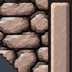 |
| dungcom-003@8  | 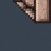 |
| dungcom-003@9 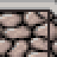 | 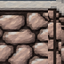 |
| dungcom-003@10 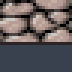 | 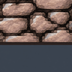 |
| dungcom-003@11 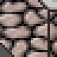 | 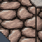 |
| dungcom-003@12 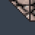 | 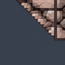 |
| dungcom-003@13 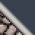 | 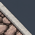 |
| dungcom-003@14 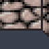 | 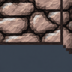 |
| dungcom-003@15 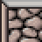 | 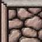 |
| dungcom-003@16 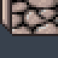 | 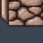 |
| dungcom-003@17 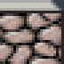 | 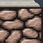 |
| dungcom-003@18 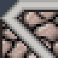 | 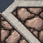 |
| dungcom-003@19 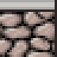 | 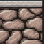 |
| dungcom-003@20 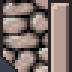 | 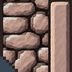 |
| dungcom-003@21 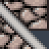 | 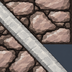 |
| dungcom-003@23 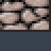 | 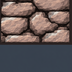 |
| dungcom-003@24 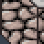 | 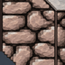 |
| dungcom-003@25  |  |

完整來源、提示詞與 SHA-256 見 [manifest.json](manifest.json)。

第9格與第5格的原始RGB只在右側32點不同。沿既有來源差異遮罩流程保留相同區域，只在來源差異遮罩外擴6個輸出像素內使用第9格AI重繪；遮罩外差異0，不表示動畫順序或時間。

下圖是原始RGB差異遮罩，白色為來源差異，前處理另向外擴6個輸出像素：

來源與失敗版本的限制見[研究017](../../../docs/re/017-vga-battle-hd.md#b30-terrain)。
