# HD 圖片審閱

風格 B，沿用使用者確認的奇幻手繪與原版配色。
本頁為素材對照；執行期覆蓋範圍見[主審閱入口](../README.md)。

| 來源 key／原版 3 倍 | HD 3 倍 |
|---|---|
| dungcom-002@0 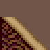 | 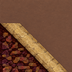 |
| dungcom-002@1 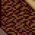 | 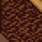 |
| dungcom-002@2 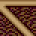 | 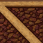 |
| dungcom-002@3 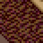 | 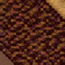 |
| dungcom-002@4 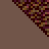 | 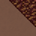 |
| dungcom-002@5 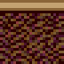 | 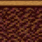 |
| dungcom-002@6 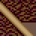 | 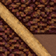 |
| dungcom-002@7 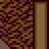 | 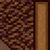 |
| dungcom-002@8 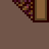 | 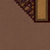 |
| dungcom-002@9 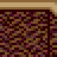 | 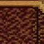 |
| dungcom-002@10 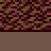 | 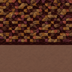 |
| dungcom-002@11 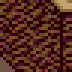 | 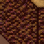 |
| dungcom-002@12 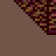 | 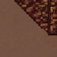 |
| dungcom-002@13 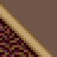 | 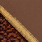 |
| dungcom-002@14  | 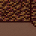 |
| dungcom-002@15 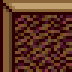 | 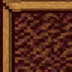 |
| dungcom-002@16  | 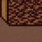 |
| dungcom-002@17 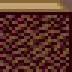 | 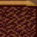 |
| dungcom-002@18 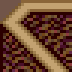 | 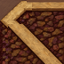 |
| dungcom-002@19 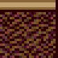 | 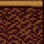 |
| dungcom-002@20 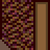 | 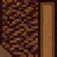 |
| dungcom-002@21 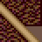 | 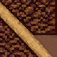 |
| dungcom-002@23 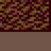 | 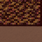 |
| dungcom-002@24 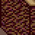 | 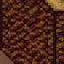 |
| dungcom-002@25  | 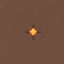 |

完整來源、提示詞與 SHA-256 見 [manifest.json](manifest.json)。

15組靜態來源差異遮罩沿已接受AI基底，外擴6個輸出像素，遮罩外差異0；不是動畫時間證據。配對與差異見[source-pairs.json](source-pairs.json)，純色排除見[excluded.json](excluded.json)。
