# HD 圖片審閱

風格 B，沿用使用者確認的奇幻手繪與原版配色。
本頁為素材對照；執行期覆蓋範圍見[主審閱入口](../README.md)。

| 來源 key／原版 3 倍 | HD 3 倍 |
|---|---|
| dungcom-001@0 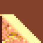 | 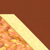 |
| dungcom-001@1 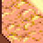 | 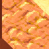 |
| dungcom-001@2  |  |
| dungcom-001@3 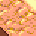 | 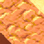 |
| dungcom-001@4  | 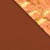 |
| dungcom-001@5  | 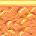 |
| dungcom-001@6  |  |
| dungcom-001@7 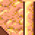 | 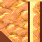 |
| dungcom-001@8  | 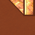 |
| dungcom-001@9 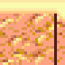 | 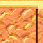 |
| dungcom-001@10  | 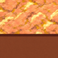 |
| dungcom-001@11 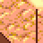 | 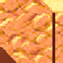 |
| dungcom-001@12  | 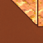 |
| dungcom-001@13 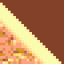 |  |
| dungcom-001@14 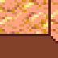 | 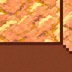 |
| dungcom-001@15  | 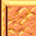 |
| dungcom-001@16  | 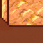 |
| dungcom-001@17  | 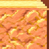 |
| dungcom-001@18  |  |
| dungcom-001@19  | 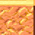 |
| dungcom-001@20 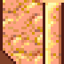 | 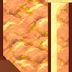 |
| dungcom-001@21 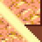 |  |
| dungcom-001@23  | 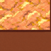 |
| dungcom-001@24 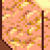 | 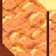 |
| dungcom-001@25 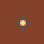 |  |

完整來源、提示詞與 SHA-256 見 [manifest.json](manifest.json)。

15組靜態來源差異遮罩沿已接受AI基底，外擴6個輸出像素，遮罩外差異0，不推論動畫時間。配對見[source-pairs.json](source-pairs.json)，純色排除見[excluded.json](excluded.json)。
