# HD 圖片審閱

風格 B，沿用使用者確認的奇幻手繪與原版配色。
本頁為素材對照；執行期覆蓋範圍見[主審閱入口](../README.md)。

| 來源 key／原版 3 倍 | HD 3 倍 |
|---|---|
| dungcom-006@0 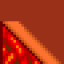 |  |
| dungcom-006@1 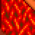 |  |
| dungcom-006@2  |  |
| dungcom-006@3 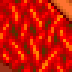 |  |
| dungcom-006@4  |  |
| dungcom-006@5  |  |
| dungcom-006@6  |  |
| dungcom-006@7 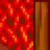 | 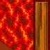 |
| dungcom-006@8  | 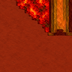 |
| dungcom-006@9  |  |
| dungcom-006@10  | 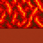 |
| dungcom-006@11 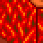 |  |
| dungcom-006@12  |  |
| dungcom-006@13 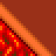 |  |
| dungcom-006@14  | 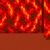 |
| dungcom-006@15 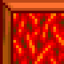 | 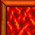 |
| dungcom-006@16  | 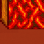 |
| dungcom-006@17  |  |
| dungcom-006@18 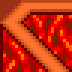 |  |
| dungcom-006@19  | 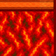 |
| dungcom-006@20 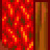 | 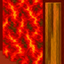 |
| dungcom-006@21  | 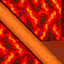 |
| dungcom-006@23 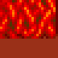 | 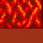 |
| dungcom-006@24 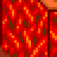 |  |
| dungcom-006@25  | 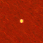 |

完整來源、提示詞與 SHA-256 見 [manifest.json](manifest.json)。

本批為地下城第六組25張；第22格純色保留。15組靜態變體沿來源差異遮罩外擴6像素，相同區域沿已接受手繪基底。正常遭遇尚未觀測；完整驗證見[本批收據](../../../docs/re/017-vga-battle-hd.md#b33-terrain)。
