# HD 圖片審閱

風格 B，沿用使用者確認的奇幻手繪與原版配色。
本頁為素材對照；執行期覆蓋範圍見[主審閱入口](../README.md)。

| 來源 key／原版 3 倍 | HD 3 倍 |
|---|---|
| wildcom-000@0 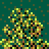 | 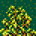 |
| wildcom-000@1 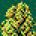 | 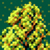 |
| wildcom-000@2 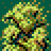 | 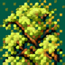 |
| wildcom-000@3 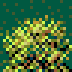 | 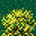 |
| wildcom-000@4 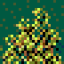 | 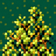 |
| wildcom-000@5 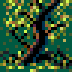 | 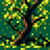 |
| wildcom-000@6 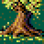 |  |
| wildcom-000@7 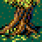 | 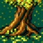 |
| wildcom-000@8 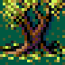 | 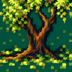 |
| wildcom-000@9 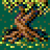 |  |
| wildcom-000@10 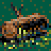 | 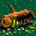 |
| wildcom-000@11 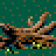 | 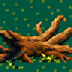 |

完整來源、提示詞與 SHA-256 見 [manifest.json](manifest.json)。

本批為WILDCOM第0組第0–11格。正常野外遭遇未觀測；驗證範圍見[研究017](../../../docs/re/017-vga-battle-hd.md#b34-wild-terrain)。
