# HD 圖片審閱

風格 B，沿用使用者確認的奇幻手繪與原版配色。
本頁為素材對照；執行期覆蓋範圍見[主審閱入口](../README.md)。

| 來源 key／原版 3 倍 | HD 3 倍 |
|---|---|
| wildcom-000@12 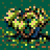 |  |
| wildcom-000@13 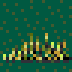 |  |
| wildcom-000@14 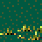 | 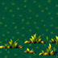 |
| wildcom-000@15 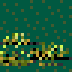 |  |
| wildcom-000@16 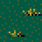 | 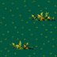 |
| wildcom-000@17 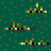 | 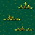 |
| wildcom-000@18 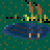 | 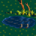 |
| wildcom-000@19 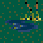 | 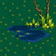 |
| wildcom-000@20 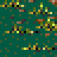 | 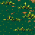 |
| wildcom-000@21 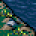 | 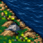 |
| wildcom-000@22 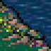 | 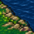 |
| wildcom-000@23 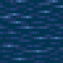 | 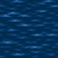 |
| wildcom-000@24 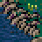 |  |
| wildcom-000@25 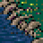 |  |
| wildcom-000@26 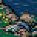 | 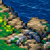 |
| wildcom-000@27 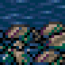 | 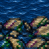 |
| wildcom-000@28 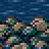 |  |
| wildcom-000@29 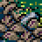 | 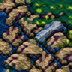 |
| wildcom-000@30 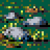 | 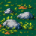 |
| wildcom-000@31 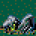 | 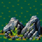 |
| wildcom-000@32 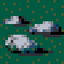 | 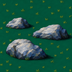 |
| wildcom-000@33 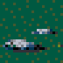 | 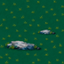 |
| wildcom-000@34 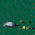 | 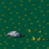 |
| wildcom-000@35 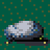 | 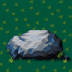 |
| wildcom-000@36 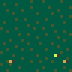 | 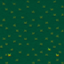 |
| wildcom-000@37  | 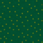 |
| wildcom-000@38 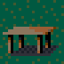 | 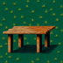 |
| wildcom-000@39 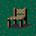 |  |

完整來源、提示詞與 SHA-256 見 [manifest.json](manifest.json)。

本批補齊第0組第12–39格。執行期固定抽驗第12、21、23、29、35、39格及一條正常DEMO；其餘22張不宣稱逐件執行期驗證。正常野外遭遇未觀測，詳[研究017](../../../docs/re/017-vga-battle-hd.md#b35-wild-terrain)。
