# HD 圖片審閱

風格 B，沿用使用者確認的奇幻手繪與原版配色。
本頁為素材對照；執行期覆蓋範圍見[主審閱入口](../README.md)。

| 來源 key／原版 3 倍 | HD 3 倍 |
|---|---|
| wildcom-002@0 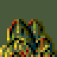 | 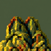 |
| wildcom-002@1 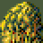 | 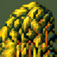 |
| wildcom-002@2 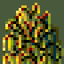 | 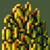 |
| wildcom-002@3 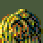 | 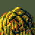 |
| wildcom-002@4 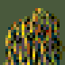 | 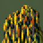 |
| wildcom-002@5 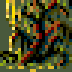 | 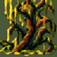 |
| wildcom-002@6 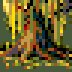 | 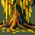 |
| wildcom-002@7 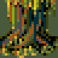 | 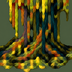 |
| wildcom-002@8 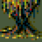 | 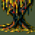 |
| wildcom-002@9 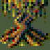 | 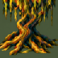 |
| wildcom-002@10 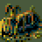 | 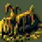 |
| wildcom-002@11 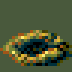 | 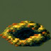 |
| wildcom-002@12 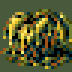 | 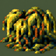 |
| wildcom-002@13 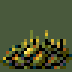 | 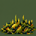 |
| wildcom-002@14 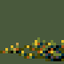 | 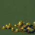 |
| wildcom-002@15 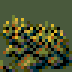 | 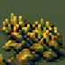 |
| wildcom-002@16 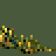 | 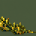 |
| wildcom-002@17 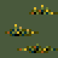 | 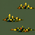 |
| wildcom-002@18  |  |
| wildcom-002@19 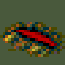 | 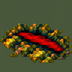 |
| wildcom-002@20 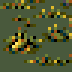 | 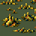 |
| wildcom-002@21 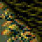 | 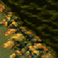 |
| wildcom-002@22 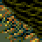 | 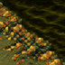 |
| wildcom-002@23 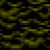 | 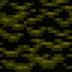 |
| wildcom-002@24 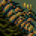 | 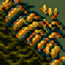 |
| wildcom-002@25 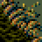 | 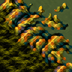 |
| wildcom-002@26  |  |
| wildcom-002@27  |  |
| wildcom-002@28  |  |
| wildcom-002@29  |  |
| wildcom-002@30  |  |
| wildcom-002@31  |  |
| wildcom-002@32  |  |
| wildcom-002@33  |  |
| wildcom-002@34  |  |
| wildcom-002@35  |  |
| wildcom-002@36  |  |
| wildcom-002@37  |  |
| wildcom-002@39  |  |

完整來源、提示詞與 SHA-256 見 [manifest.json](manifest.json)。

本批包含第 2 組 39 個非純色格。第 38 格為純色，維持原版，見 [excluded.json](excluded.json)。執行期固定抽驗第 0、6、18、23、31、39 格，其他 33 格未逐例執行。正常野外遭遇仍未抽到。
