# HD 圖片審閱

風格 B，沿用使用者確認的奇幻手繪與原版配色。
本頁為素材對照；執行期覆蓋範圍見[主審閱入口](../README.md)。

| 來源 key／原版 3 倍 | HD 3 倍 |
|---|---|
| wildcom-001@0 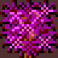 | 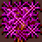 |
| wildcom-001@1 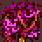 | 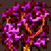 |
| wildcom-001@2 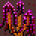 | 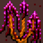 |
| wildcom-001@3  |  |
| wildcom-001@4  |  |
| wildcom-001@5  | 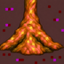 |
| wildcom-001@6  |  |
| wildcom-001@7  | 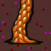 |
| wildcom-001@8  |  |
| wildcom-001@10 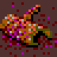 |  |
| wildcom-001@11 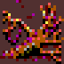 | 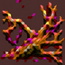 |
| wildcom-001@12  |  |
| wildcom-001@13  |  |
| wildcom-001@14 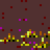 | 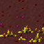 |
| wildcom-001@15 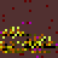 | 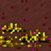 |
| wildcom-001@16 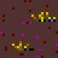 | 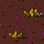 |
| wildcom-001@17 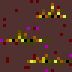 | 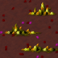 |
| wildcom-001@18  | 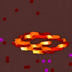 |
| wildcom-001@19 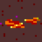 | 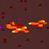 |
| wildcom-001@20 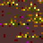 | 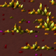 |
| wildcom-001@21 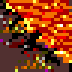 | 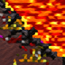 |
| wildcom-001@22 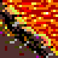 | 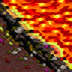 |
| wildcom-001@23 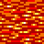 | 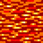 |
| wildcom-001@24 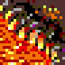 | 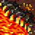 |
| wildcom-001@25  | 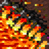 |
| wildcom-001@26 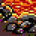 | 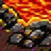 |
| wildcom-001@27 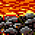 | 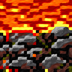 |
| wildcom-001@28 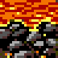 | 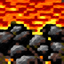 |
| wildcom-001@29 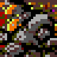 | 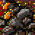 |
| wildcom-001@30  | 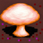 |
| wildcom-001@31  | 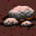 |
| wildcom-001@32  | 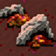 |
| wildcom-001@33  | 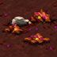 |
| wildcom-001@34 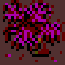 | 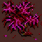 |
| wildcom-001@35  |  |
| wildcom-001@36  | 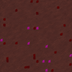 |
| wildcom-001@37  | 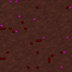 |

完整來源、提示詞與 SHA-256 見 [manifest.json](manifest.json)。

本批37張涵蓋第1組40個非純色來源。第9格逐位元同第8格，第38、39格同第37格，見[來源對應](source-aliases.json)。固定抽驗第0、4、18、23、30、37格，其他31張未逐例執行。來源插入不代表正常野外遭遇已觀測。
