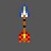
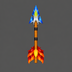
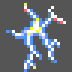
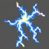
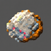
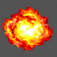

# HD 圖片審閱

風格 B，沿用使用者確認的奇幻手繪與原版配色。
本頁為素材對照；執行期覆蓋範圍見[主審閱入口](../README.md)。

000箭矢在鏡像與相鄰位置同時吻合時保留原版。009骷髏已找到正常戰鬥來源；其餘事件的來源診斷不代表正常施法路徑驗收。

| 來源 key／原版 3 倍 | HD 3 倍 |
|---|---|
| comspr-000  |  |
| comspr-005  |  |
| comspr-006  |  |
| comspr-009  |  |
| comspr-010  |  |
| comspr-013  |  |

完整來源、提示詞與 SHA-256 見 [manifest.json](manifest.json)。
