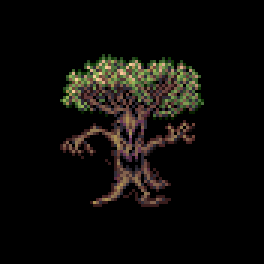
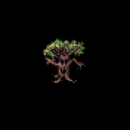

# HD 圖片審閱

風格 B，沿用使用者確認的奇幻手繪與原版配色。
本頁為素材對照；執行期覆蓋範圍見[主審閱入口](../README.md)。

| 來源 key／原版 3 倍 | HD 3 倍 |
|---|---|
| sprit1-005@0  |  |
| sprit1-005@1  |  |
| sprit1-005@2  |  |
| sprit1-027@0  |  |
| sprit1-027@1  |  |
| sprit1-027@2  |  |
| sprit1-028@0  |  |
| sprit1-028@1  |  |
| sprit1-028@2  |  |
| sprit1-029@0  |  |
| sprit1-029@1  |  |
| sprit1-029@2  |  |
| sprit1-030@0  |  |
| sprit1-030@1  |  |
| sprit1-030@2  |  |
| sprit1-042@0  |  |
| sprit1-042@1  |  |
| sprit1-042@2  |  |
| sprit1-053@0  |  |
| sprit1-053@1  |  |
| sprit1-053@2  |  |
| sprit1-069@0  |  |
| sprit1-069@1  |  |
| sprit1-069@2  |  |

完整來源、提示詞與 SHA-256 見 [manifest.json](manifest.json)。
