# HD 圖片審閱

風格 B，沿用使用者確認的奇幻手繪與原版配色。
本頁為素材對照；執行期覆蓋範圍見[主審閱入口](../README.md)。

| 來源 key／原版 3 倍 | HD 3 倍 |
|---|---|
| sprit1-008@0 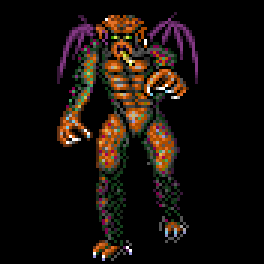 |  |
| sprit1-008@1 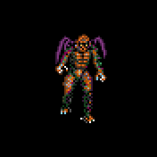 |  |
| sprit1-008@2 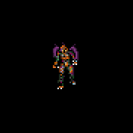 | 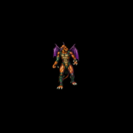 |
| sprit1-015@0  |  |
| sprit1-015@1 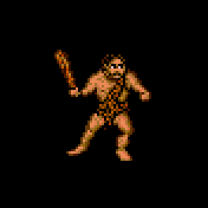 |  |
| sprit1-015@2  | 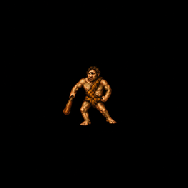 |
| sprit1-017@0 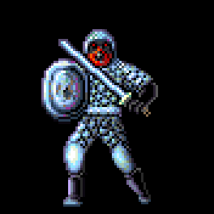 |  |
| sprit1-017@1 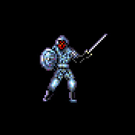 | 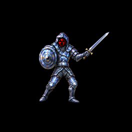 |
| sprit1-017@2 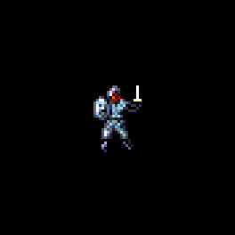 | 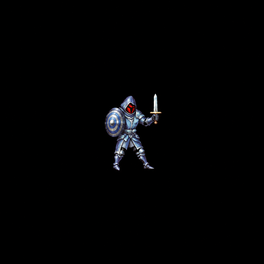 |
| sprit1-023@0  |  |
| sprit1-023@1  |  |
| sprit1-023@2 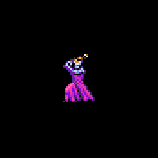 |  |
| sprit1-045@0  |  |
| sprit1-045@1 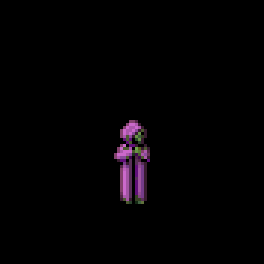 | 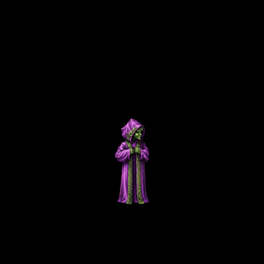 |
| sprit1-045@2 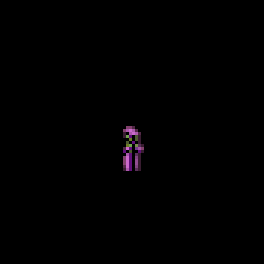 | 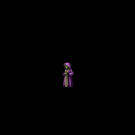 |
| sprit1-046@0  |  |
| sprit1-046@1 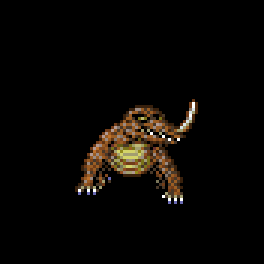 | 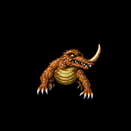 |
| sprit1-046@2 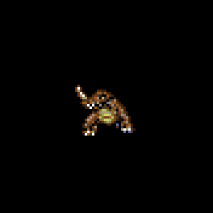 |  |
| sprit1-051@0  |  |
| sprit1-051@1  | 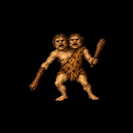 |
| sprit1-051@2 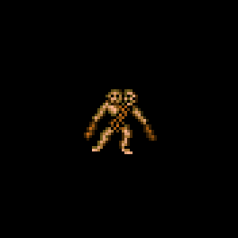 | 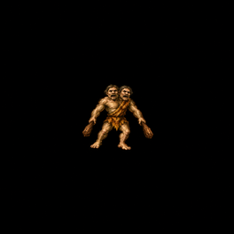 |
| sprit1-066@0 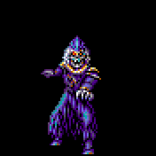 |  |
| sprit1-066@1 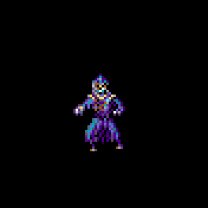 | 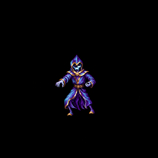 |
| sprit1-066@2 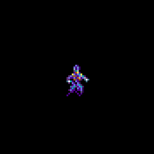 | 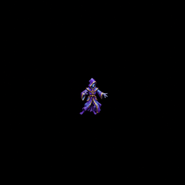 |
| sprit1-067@0  |  |
| sprit1-067@1 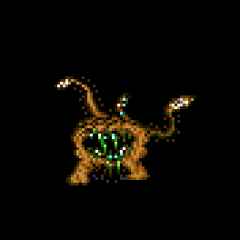 | 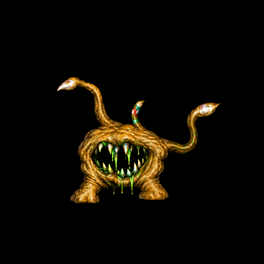 |
| sprit1-067@2 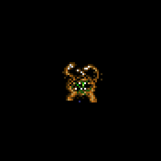 |  |
| sprit1-074@0 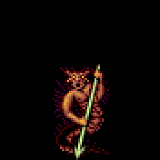 |  |
| sprit1-074@1 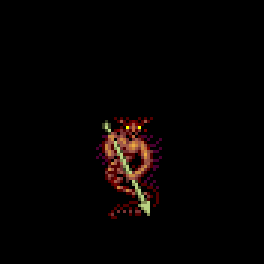 | 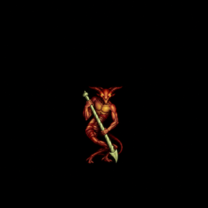 |
| sprit1-074@2 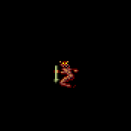 | 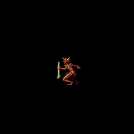 |
| sprit1-076@0  |  |
| sprit1-076@1  |  |
| sprit1-076@2  |  |
| sprit1-079@0  |  |
| sprit1-079@1 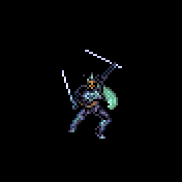 | 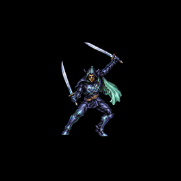 |
| sprit1-079@2 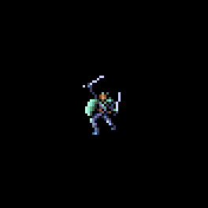 |  |
| sprit1-081@0  |  |
| sprit1-081@1 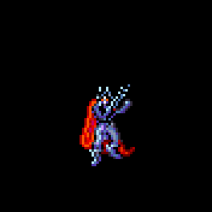 | 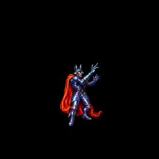 |
| sprit1-081@2 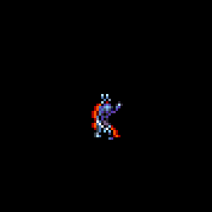 | 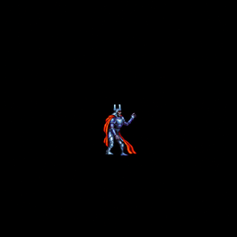 |
| sprit1-082@0  | 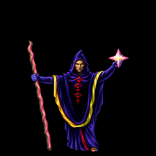 |
| sprit1-082@1 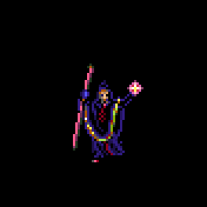 | 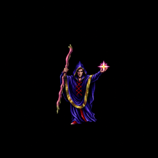 |
| sprit1-082@2 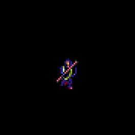 | 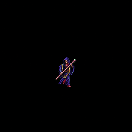 |
| sprit1-083@0 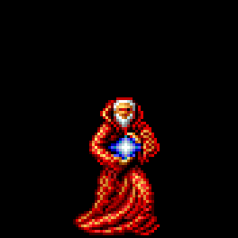 |  |
| sprit1-083@1 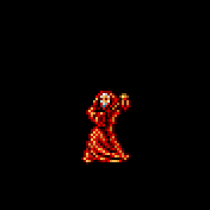 |  |
| sprit1-083@2 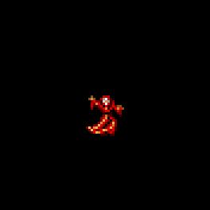 |  |
| sprit1-084@0  |  |
| sprit1-084@1  |  |
| sprit1-084@2  |  |
| sprit1-087@0  |  |
| sprit1-087@1  |  |
| sprit1-087@2  |  |
| sprit1-090@0  |  |
| sprit1-090@1  |  |
| sprit1-090@2  |  |
| sprit1-096@0  |  |
| sprit1-096@1  |  |
| sprit1-096@2  |  |
| sprit1-108@0  |  |
| sprit1-108@1  |  |
| sprit1-108@2  |  |

完整來源、提示詞與 SHA-256 見 [manifest.json](manifest.json)。
