# HD 圖片審閱

風格 B，沿用使用者確認的奇幻手繪與原版配色。
六張960×504關鍵畫面已驗收，完整動畫尚未接入。下方是素材並列，不能當作HD動畫已在正常流程播放的證據。來源與範圍見[固定盤點](../../../docs/re/018-b44-source-proof.json)。
本頁為素材對照；執行期覆蓋範圍見[主審閱入口](../README.md)。

| 來源 key／原版 3 倍 | HD 3 倍 |
|---|---|
| intro-council 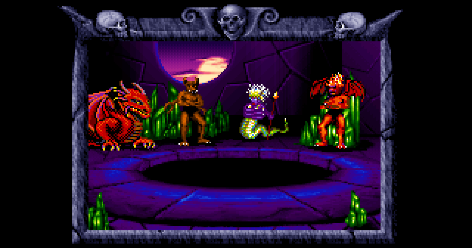 | 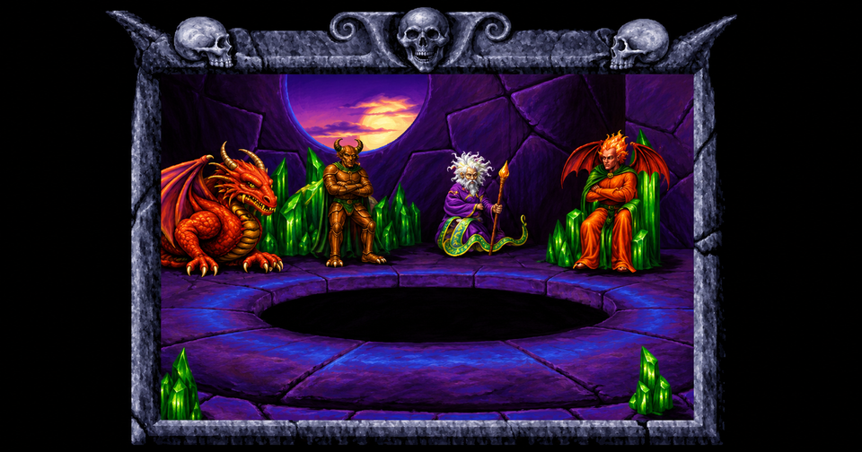 |
| intro-phlan 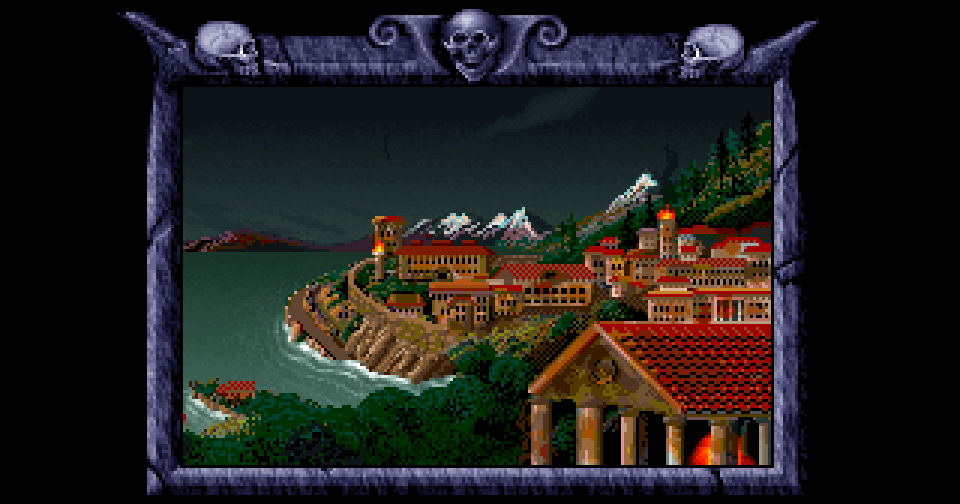 | 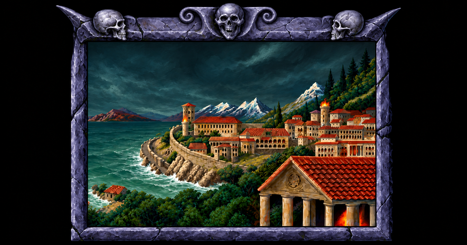 |
| intro-horned 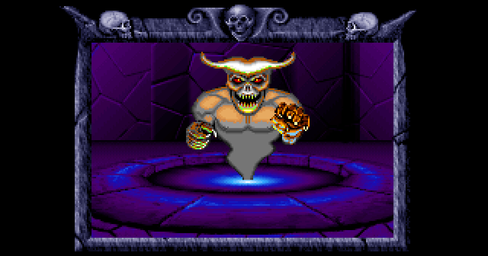 | 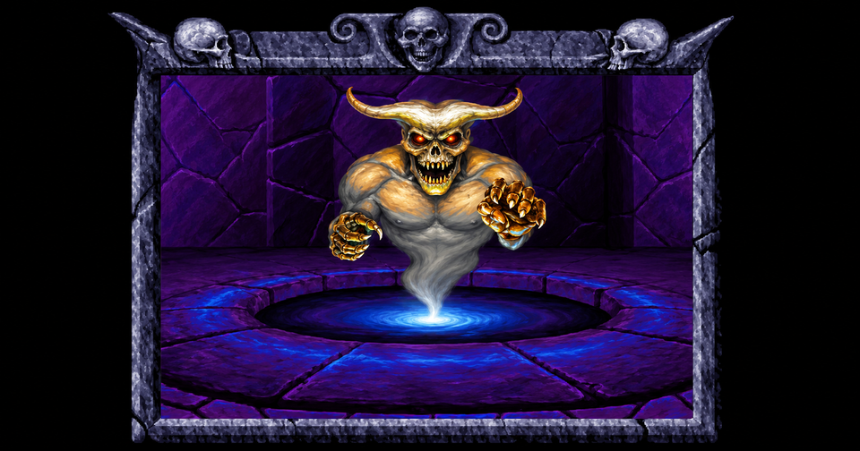 |
| intro-heroes 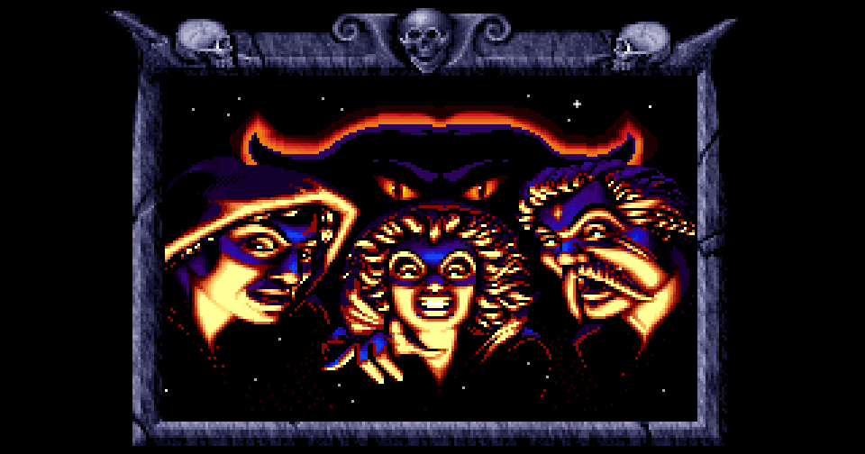 | 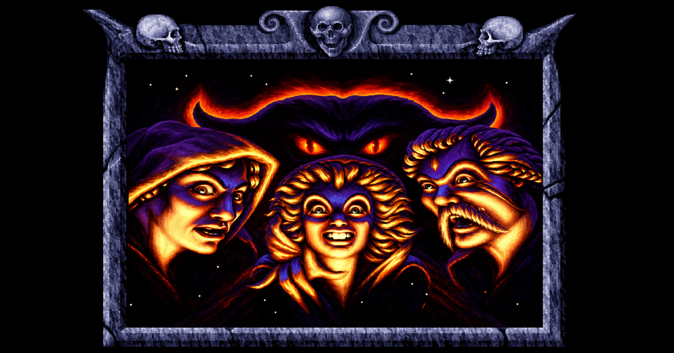 |
| intro-followers 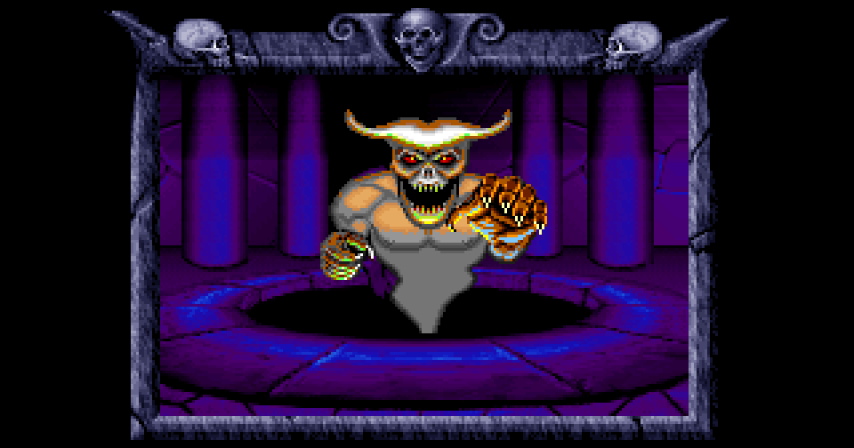 | 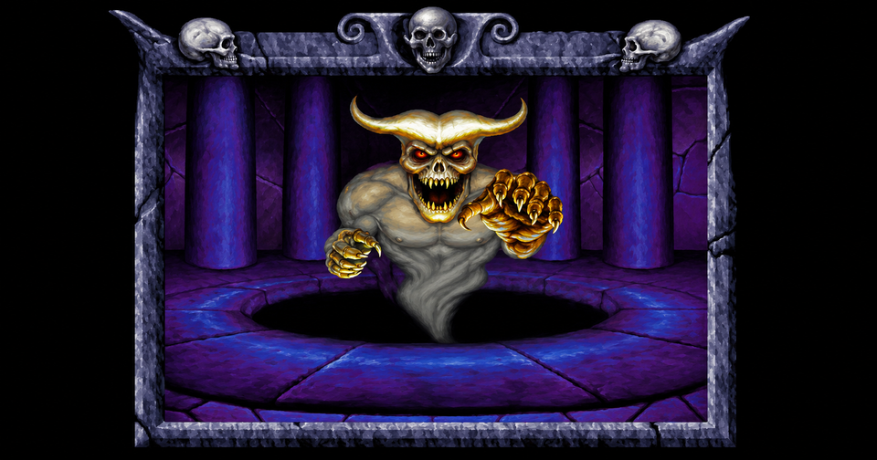 |
| intro-dreadlord 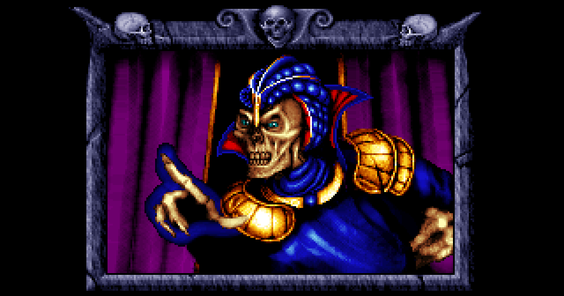 | 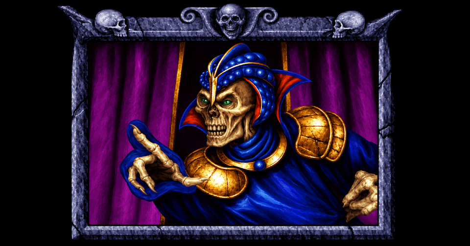 |

完整來源、提示詞與 SHA-256 見 [manifest.json](manifest.json)。

後續接入見[b46敘事動畫](../b46-intro/README.md)與[031驗收](../../../docs/re/031-intro-bma.md#片頭hd接入驗收)。本頁保留六張主畫面的原素材紀錄。
