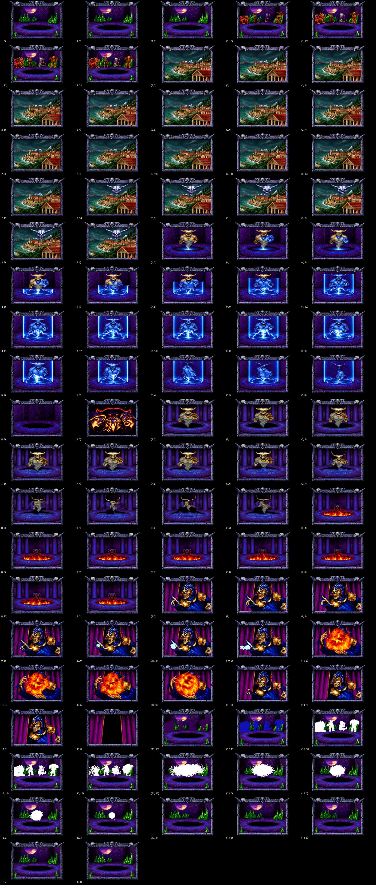

# 片頭敘事動畫HD

Issue [#74](https://github.com/wicanr2/pools-of-darkness-cht/issues/74)，契約見[規格010](../../../docs/spec/010-hd-theme.md#bma片頭動畫接入)，原版來源見[研究031](../../../docs/re/031-intro-bma.md)。本目錄保存97種敘事相位的960×504不透明成品；SSI標誌保留原版。下方字幕由既有系統處理。

六張b44核准主畫面逐像素保留。其餘相位由七份新增生成素材及原版來源引導合成；材質變形與HD明暗屬美術近似，原版仍決定相位、播放順序、布幕與淡出。不是原版逐像素動作對拍聲明。

- [來源、生成提示詞與輸入](generation.json)
- [成品與目視SHA](manifest.json)
- [數值驗收](validation.json)
- [執行期清單](intro.json)，原始索引與有序寫入表由自備INTRO.BMA重生。
- [正常執行收據](../../../docs/re/031-intro-hd-runtime.json)

前處理入口為[相位合成](../../../tools/intro_hd_art.py)、[數值檢查](../../../tools/intro_hd_validate.py)及[主題建置](../../../tools/intro_hd_theme.py)。工具鏈見[鎖版Dockerfile](../../../tools/docker/intro-img.Dockerfile)。乾淨Git素材重建依[SETUP](../../../SETUP.md)執行`tools/rebuild.sh assets`，不需要舊聊天或生圖目錄。

此頁及素材保存於既有私人儲存庫範圍。原版索引、色盤、BMA及ACF不加入Git。
