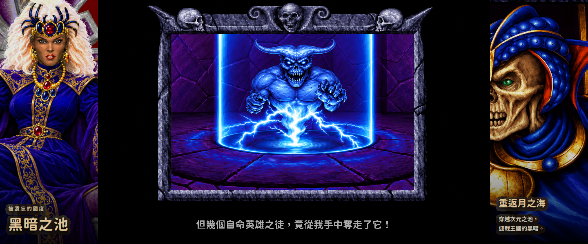

# B版HD海報

使用者於2026-11-01以「ok 繼續囉 B」確認。來源與成品SHA見[manifest](manifest.json)，對應[#75](https://github.com/wicanr2/pools-of-darkness-cht/issues/75)及[規格012](../../../docs/spec/012-package.md#hd-patch-原版辨識資料匯入)。

三倍兩側與核准原型逐像素相同，文字維持既有獨立語系層。兩倍從同一生圖素材前處理，中央遊戲畫面與版面不變。

左側沿用已核准TITLE2生圖，右側沿用b44恐怖魔王生圖原檔，沒有重新生成或換構圖。[A／B比較](approved-comparison.png)包含原版盒繪，只供私人審閱；patch只採四張無字HD背景及既有文字層。
