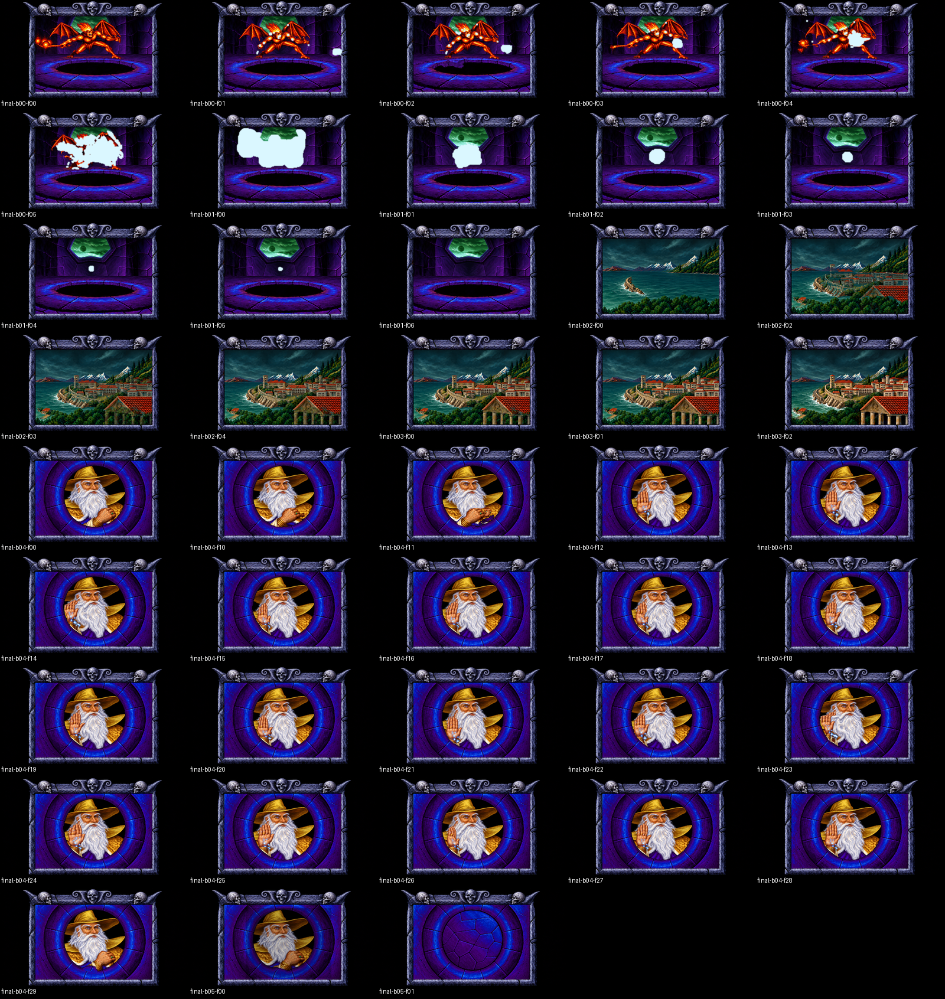
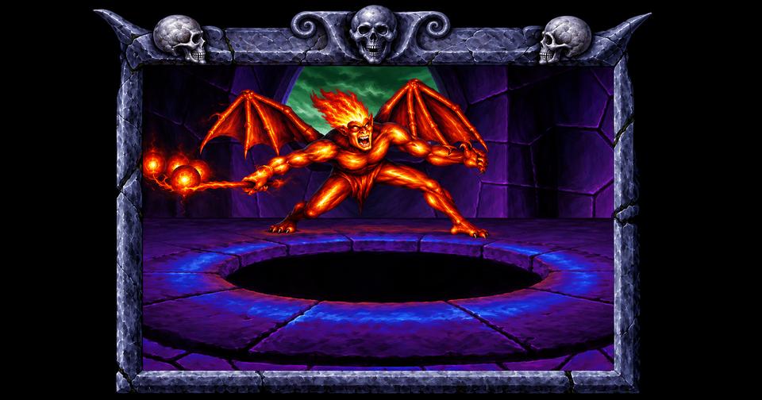
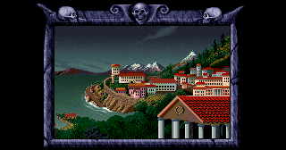
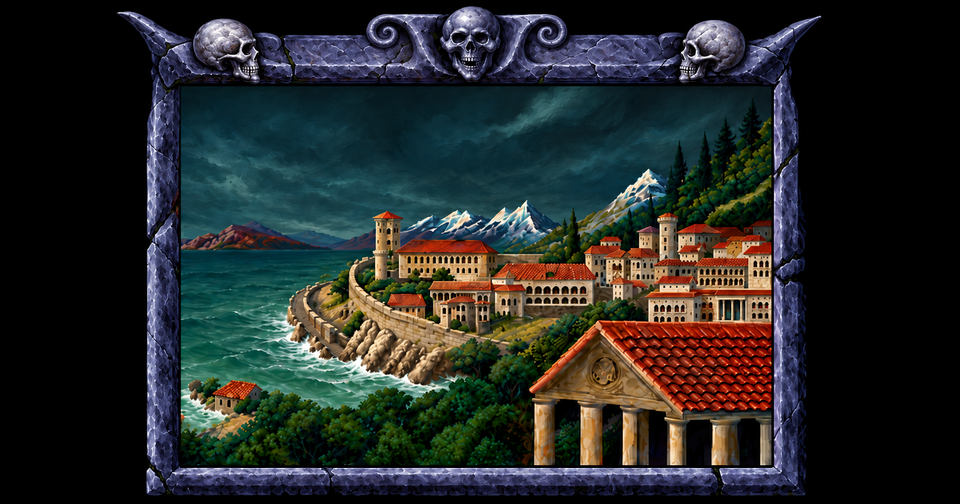
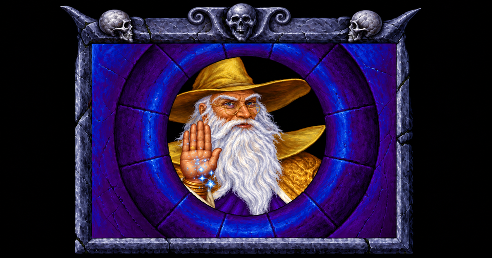

# b48 片尾 FINAL

[Issue 77](https://github.com/wicanr2/pools-of-darkness-cht/issues/77)。沿核准風格B及原版配色，七張生成主畫面與背景組成43種960×504相位，對應原版六區塊58圖。巨龍、能量消散、菲蘭城復原、法師揮手與圓門關閉均已接入。

| 原版解碼參考 | HD成品 |
|---|---|
|  |  |
|  |  |
|  |  |

上表原版參考由FINAL.BMA重建索引，配上該區塊實測的完整亮度色盤，並非各相位的執行期截圖。實際播放器截圖與同狀態驗證見[研究035](../../../docs/re/035-final-hd.md)。直接入口抽驗不代表已重播完整通關。

- [生成紀錄](plates/generations.json)保存七次內建image_gen的提示詞、原版參考及來源路徑；`plates/`同存生成原圖與正規化主畫面。來源路徑僅供追溯，跨機重建直接讀本頁成品。
- [數值驗收](metrics.json)逐張保存成品SHA、原版來源、結構與色相分數；全部通過既定0.4及30度閘門。
- [目視紀錄](visual-review.json)綁定43張成品及完整相位表SHA，另以原尺寸抽查巨龍、城市顯露、法師揮手及關門。城市顯露遮罩維持原版稀疏線條，不提前膨脹成完整城景。
- [呈現資料](final.json)保存來源與有序寫入表雜湊。原版索引及寫入表不在Git，由[重建入口](../../../SETUP.md)從自備FINAL.BMA重生。

原版播放器決定圖格、順序與色盤。HD材質位移、光效及顯露屬美術近似。上方168列覆繪，下方32列維持原版；未知來源或色盤回退，F2二倍與F12原版旁路。

`original/`是私人原版比較資料，包含下方32列的字幕檢查。公開前須依AGENTS.md移除並清理歷史；可散布patch只取已驗HD成品及重建配方。
